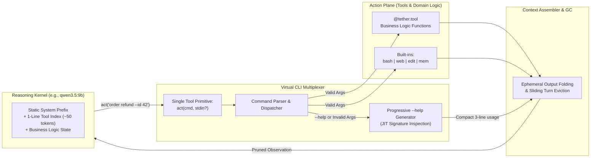

# 🪢 Tether

**A general-purpose, LLM-Native micro-harness engineered for small context windows and high-signal business logic.**

[-6366f1)](#theoretical-foundation)
[-10b981)](#why-tether)
[](#quickstart-preview)

---

## Why Tether?

Modern agent frameworks treat context windows as infinite dumping grounds. Before your application even processes a single line of business logic, typical harnesses inject **3,000–8,000+ tokens** of verbose JSON tool schemas, sprawling system prompts, and unpruned execution traces.

On frontier cloud models, that waste is merely expensive. On local and edge models like **`qwen3.5:9b`**, it is fatal:
1. **Attention Dilution:** Flooding the prompt with dozens of JSON schemas degrades reasoning accuracy on the actual domain task.
2. **Structured-Output Fragility:** Small models frequently hallucinate escaping or nested JSON structures when forced to choose among 20+ complex function-calling schemas.
3. **KV-Cache Thrashing:** Dynamically mutating the `tools` array between turns invalidates prefix caches in local inference servers (`Ollama`, `llama.cpp`, `vLLM`), tanking latency.

**Tether** keeps your LLM, tools, and business logic tied together with minimal overhead—reserving **>90% of the active context window** for your domain problem.

---

## Theoretical Foundation

Tether's architecture is grounded in the paradigm defined by **Maia et al. (2026)**, *"LLM-Native Applications as a Paradigm for AI-Driven Software Architecture"*:

- **LLM as the Core Reasoning Engine:** Rather than bolting an LLM onto rigid deterministic workflows or letting an unguarded prompt loop run wild, Tether structures the application around a **probabilistic reasoning kernel** bounded by **deterministic architectural envelopes**.
- **Explicit Context & State Governance:** Context is treated as a scarce, managed L1 cache—not an append-only chat log.
- **First-Class AI Quality Attributes:** Tether prioritizes **Context Economy**, **KV-Cache Stability**, **Probabilistic Reliability** (self-healing tool invocations), and **Semantic Observability**.

---

## Core Innovation: Virtual CLI Multiplexer + Progressive `--help`

Instead of registering dozens of JSON schemas with the model provider, Tether exposes a **single static action primitive** and multiplexes all built-in tools (`bash`, `web`, `edit`, `mem`) and custom Python business functions through a virtual POSIX-style command bus.



### How It Saves Context & Boosts 9B Reliability

| Mechanism | Traditional Harnesses | Tether Micro-Harness |
| :--- | :--- | :--- |
| **Tool Definitions in Prompt** | 15–30 full JSON Schemas (~4,000 tokens) | **1 primitive (`act`) + 1-line index (~60 tokens)** |
| **KV-Cache Behavior** | Invalidated whenever tools are added/filtered | **100% Prefix-Cache Hit** (static system + tool header) |
| **Schema Discovery** | Everything upfront (whether needed or not) | **Progressive `--help`** (loaded JIT on demand or syntax error) |
| **Multiline Code / Payloads** | Deeply escaped JSON strings (high failure rate on 9B) | **Clean `stdin` block** (`act(cmd, stdin=...)`) |
| **Noisy Tool Outputs** | Raw bash/HTML stays in history forever | **Ephemeral Output Folding** (collapsed after $N$ turns) |

### 1. The Single Action Primitive (`act`)
The model only ever sees one tool definition:
```json
{
  "name": "act",
  "description": "Execute a virtual CLI command from the Tether toolbox.",
  "parameters": {
    "cmd": "Command string, e.g. 'web search \"query\"' or '<tool> --help'",
    "stdin": "Optional multiline payload (file content, patch, JSON body, or script)"
  }
}
```
Because `stdin` is separated from `cmd`, small models never struggle with shell-escaping multiline file edits or payloads.

### 2. Progressive `--help` (Just-In-Time Disclosure)
The system prompt contains only a compact 1-line-per-tool directory:
```text
[TETHER TOOLBOX] Run `<cmd> --help` for arguments.
- bash      : Execute sandboxed shell commands
- web       : Search the web or fetch clean markdown from a URL
- edit      : View, create, or patch files via stdin
- invoice   : [Domain] Query, issue, or refund customer invoices
```
When the model needs `invoice`, or if it calls `invoice` with missing arguments, Tether intercepts the call and returns a concise, auto-generated usage spec derived from your Python type hints and docstring—**without a Python traceback**.

### 3. Ephemeral Output Folding (Context Garbage Collection)
Tool inspections (`--help`), verbose `bash` logs, and `web` scrapes are tagged as **ephemeral observations**. Tether's Context Assembler keeps their full content for the immediate reasoning step, then automatically folds them into a 1-line summary (e.g., `[Folded: bash output (142 lines, exit 0)]`) on subsequent turns.

---

## Architectural Layers (Maia et al., 2026 Alignment)

```text
┌─────────────────────────────────────────────────────────────────┐
│ 1. Application & Domain Layer                                   │
│    Business goals, domain rules, @tether.tool functions         │
├─────────────────────────────────────────────────────────────────┤
│ 2. Orchestration & Reasoning Layer (Control Plane)              │
│    Bounded ReAct loop, step budgets, guardrails, loop detection │
├─────────────────────────────────────────────────────────────────┤
│ 3. Memory & Context Layer (State Plane)                         │
│    Context Assembler, Ephemeral Output Folder, Working Memory   │
├─────────────────────────────────────────────────────────────────┤
│ 4. Tooling & Multiplexer Layer (Action Plane)                   │
│    Virtual CLI Parser, JIT --help Inspector, bash/web/edit      │
├─────────────────────────────────────────────────────────────────┤
│ 5. Model Gateway Layer (Execution Plane)                        │
│    Zero-bloat async client (Ollama, OpenAI-compatible, vLLM)    │
└─────────────────────────────────────────────────────────────────┘
```

---

## Quickstart Preview

```python
import asyncio
from tether import Harness, tool

harness = Harness(
    model="ollama/qwen3.5:9b",
    max_context_tokens=8192,
    fold_observations_after=2,  # Collapse verbose tool outputs after 2 turns
)

@tool(namespace="crm", description="Look up or update customer subscription tiers")
async def manage_subscription(customer_id: int, tier: str = "pro") -> str:
    """Update customer tier. Allowed tiers: free, pro, enterprise."""
    return f"Customer #{customer_id} updated to {tier}."

async def main():
    harness.register(manage_subscription)
    result = await harness.run(
        "Upgrade customer 1042 to enterprise and summarize the change."
    )
    print(result.output)
    print(f"Peak Context Used: {result.stats.peak_tokens} tokens")

if __name__ == "__main__":
    asyncio.run(main())
```

---

## Project Structure

```text
tether/
├── README.md
├── AGENTS.md                  # Architectural & engineering guide for coding agents
├── pyproject.toml             # Managed with uv (minimal dependencies)
├── src/
│   └── tether/
│       ├── __init__.py
│       ├── harness.py         # Main orchestration loop & lifecycle
│       ├── multiplexer.py     # Virtual CLI parser, router & JIT --help generator
│       ├── context.py         # Token budgeting, output folding & state assembly
│       ├── providers/         # Lightweight async adapters (Ollama, OpenAI-compat)
│       ├── tools/             # Built-in micro-tools (bash, web, edit, mem)
│       └── telemetry.py       # Token accounting, trace hooks & KV-cache metrics
└── tests/
```

---

## Roadmap

- [x] Architecture specification & LLM-Native blueprint (`README.md`, `AGENTS.md`)
- [ ] Core `@tool` decorator with automatic CLI parser & compact `--help` synthesis
- [ ] Virtual CLI Multiplexer (`act(cmd, stdin)`) with POSIX shlex routing
- [ ] Ephemeral Context Assembler & turn-based observation folding
- [ ] Built-in micro-tools: `bash`, `web`, `edit`, and `mem` (key-value scratchpad)
- [ ] Benchmark suite on `qwen3.5:9b` measuring token overhead vs. task completion rate

---

## References

- Maia, P. H. M., et al. (2026). *LLM-Native Applications as a Paradigm for AI-Driven Software Architecture*.
- Unix Philosophy & CLI-Multiplexed Agent Harnesses for Small Language Models.
