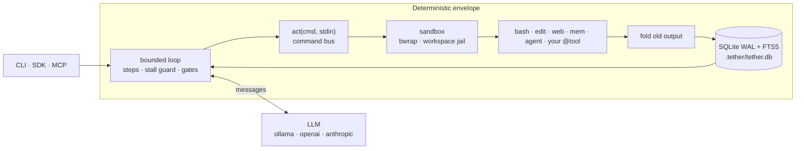

# 🪢 Tether

**A small, headless-first harness that lets small local models (and frontier ones) do real work with a tiny prompt.**

[](https://pypi.org/project/tether-sdk/)
[](https://igormcsouza.github.io/tether/)
[](#install-and-first-run)
[](https://igormcsouza.github.io/tether/reference/providers/)

```bash
uv tool install tether-sdk
tether run --model ollama/qwen3.5:9b --tools bash,edit --verify "pytest -q" "fix the failing tests"
```

## Why Tether

Most agent frameworks treat the context window as a dumping ground. Before your task is read, they inject **3,000 to 8,000 tokens** of JSON tool schemas and system prompt, then append every tool output forever. On a frontier model that is money. On a 9B model running on your laptop it is fatal: attention is diluted, small models fumble nested JSON, and changing the tool list between turns throws away the inference server's KV cache.

Tether is built the other way round:

- **One tool, not thirty.** The model sees a single `act(cmd, stdin)` schema. Everything else (`bash`, `edit`, `web`, `mem`, your own functions) is a command behind it, off by default. Fixed framing is under 150 tokens.
- **Old output folds away.** Tool results stay in full for two turns, then become a one-line tombstone. Everything lives in SQLite and comes back by search.
- **The envelope is deterministic.** Sandboxing, state, step limits, verification gates and termination are plain code. The model only reasons; it is never trusted with safety.

## How well does it work

Tether answers to one number: how many real coding exercises a small local model finishes. On the Polyglot-Python set (Aider's 34 Python exercises, graded by each exercise's own tests), `qwen3.5:9b` through Ollama, 12-exercise fast set, 2 trials each:

| | v0.2.7 | v0.2.8 |
|---|---|---|
| Passes | 10 of 24 | 11 of 24 |
| Mean score | 0.741 | 0.756 |
| "Tool call cut off" hints | 29 | 2 |
| Steps that did nothing | 19% | 2.2% |

One run is noisy (about 0.1), so read the pass count and the failure breakdown, not one decimal. Method, how to reproduce it and fair-comparison rules: [Benchmarks](https://igormcsouza.github.io/tether/benchmarks/). Every change that touches model-visible behaviour has to move this number or leave it alone.

## How it works



A session is a row in SQLite, so it survives crashes, runs detached (`--headless`), takes new instructions while running (`tether send`), and can be read by another agent as compact JSON. A task ends only when the model calls `done`, after your `--verify` commands pass.

## Why this and not that

| Decision | Instead of | Why |
|---|---|---|
| One `act` tool, commands behind it | A JSON schema per tool | CodeAct and SWE-agent results: one executable channel beats many schemas, most for 7-9B models; and the prompt prefix never changes, so the KV cache survives. |
| Progressive `--help` | Full usage up front | A tool costs about a dozen tokens until the model asks or gets it wrong. |
| SQLite (WAL, FTS5) as memory | An ever-growing transcript | Context stays a bounded working set; the rest is searchable. State is ACID, so sessions resume and agents share results. |
| Kernel sandbox (`bwrap`), env scrubbing, SSRF guard | "Please be careful" in the prompt | Safety that depends on the model obeying is not safety. |
| Explicit `done` plus verification gates | Letting the model declare success | Small models stop early or never stop. The gate is a command you wrote. |
| Thin `httpx` adapters, 2 runtime dependencies | Vendor SDKs, LangChain-style frameworks | Easy to read, easy to add a backend (`providers.yaml`, no code), nothing to upgrade around. |

The research behind it: Maia et al. (2026) on probabilistic core and deterministic envelope, Wang et al. (2024, CodeAct), Yang et al. (2024, SWE-agent) and Packer et al. (2023, MemGPT); see [References](#references) and [Architecture](https://igormcsouza.github.io/tether/architecture/).

## Install and first run

```bash
uv tool install tether-sdk            # or: pip install tether-sdk
ollama pull qwen3.5:9b                # any model works; see the providers page
tether run --model ollama/qwen3.5:9b --tools bash,edit "create hello.txt containing hi"
```

Everything else (headless sessions, skills, pipelines, MCP, the CLI reference, writing your own tool or provider) is in the docs: **[igormcsouza.github.io/tether](https://igormcsouza.github.io/tether/)**. Start with the guides: [fix a failing test](https://igormcsouza.github.io/tether/guides/fix-a-failing-test/), [use it from Claude Code or Codex](https://igormcsouza.github.io/tether/guides/use-tether-from-your-agent/).

## Build on it

```python
import asyncio

from tether import Harness, tool


@tool(name="price", description="Look up the unit price of a fruit")
def price(fruit: str) -> str:
    return f"{fruit}: 0.50 EUR"


async def main() -> None:
    harness = Harness(model="ollama/qwen3.5:9b", tools=[price])
    session = await harness.run("What does an apple cost?")
    print(session.result)


asyncio.run(main())
```

`Harness`, `Pipeline`, `Skill`, `SandboxPolicy`, `@tool` and `register_provider` are the public surface. The agent-facing JSON and the optional `tether mcp` server (`tether-sdk[mcp]`) are specified in the [reference](https://igormcsouza.github.io/tether/reference/agent-interface/).

## Contributing

Tether stays lightweight, reliable, extensible, model-agnostic, easy to use, resourceful and a token saver; a change that fails one of those lines is reworked. Read [AGENTS.md](AGENTS.md) (the rules and the module map) and [CONTRIBUTING.md](CONTRIBUTING.md) (setup, checks, golden traces, e2e, the bench, releasing). Open an issue before a large change; small fixes with a test and a docs line are welcome as they are.

```text
tether/        harness · multiplexer · context · store · sandbox · providers/ · tools/
tests/         unit, golden traces (what the model sees), 100% coverage
e2e/           real CLI and real Ollama behind a fault-injecting proxy (local)
bench/         Polyglot-Python and model checks (developers)
docs/          the user site (MkDocs)
```

---

## References

1. **Maia, P. H. M., et al. (2026).** *LLM-Native Applications as a Paradigm for AI-Driven Software Architecture*.
2. **Wang, X., Chen, Y., Yuan, L., Zhang, Y., Li, Y., Peng, H., & Ji, H. (2024).** *Executable Code Actions Elicit Better LLM Agents (CodeAct)*. In **Proceedings of the 41st International Conference on Machine Learning (ICML 2024)**. [arXiv:2402.01030](https://arxiv.org/abs/2402.01030)
3. **Yang, J., Jimenez, C. E., Wettig, A., Lieret, K., Yao, S., Narasimhan, K., & Press, O. (2024).** *SWE-agent: Agent-Computer Interfaces Enable Automated Software Engineering*. In **Advances in Neural Information Processing Systems (NeurIPS 2024)**. [arXiv:2405.15793](https://arxiv.org/abs/2405.15793)
4. **Packer, C., Wooders, S., Lin, K., Fang, V., Patil, S. G., Stoica, I., & Gonzalez, J. E. (2023).** *MemGPT: Towards LLMs as Operating Systems*. [arXiv:2310.08560](https://arxiv.org/abs/2310.08560)
