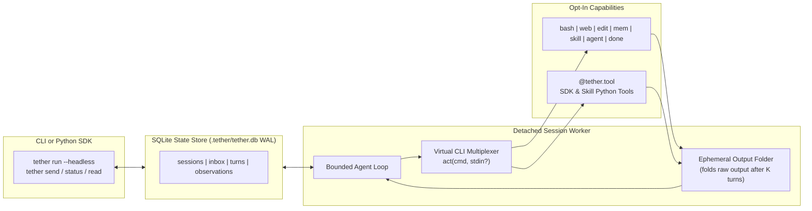

# 🪢 Tether

**A general-purpose, headless-first LLM-Native micro-harness engineered for small context windows and high-signal business logic.**

[-6366f1)](#theoretical-foundation)
[%20%7C%20Claude%20%7C%20GPT-10b981)](#multi-model-zero-bloat-adapters)
[](#quickstart)

---

## Why Tether?

Modern agent frameworks treat context windows as infinite dumping grounds. Before your application processes a single line of business logic, typical harnesses inject **3,000–8,000+ tokens** of verbose JSON tool schemas, sprawling system prompts, and unpruned execution traces.

On frontier cloud models, that waste is expensive. On local and small models like **`qwen3.5:9b`**, it is fatal:
1. **Attention Dilution:** Flooding the prompt with dozens of unused tool schemas degrades reasoning accuracy on the actual domain task.
2. **Structured-Output Fragility:** Small models frequently hallucinate escaping or nested JSON structures when forced to choose among 20+ complex function-calling schemas.
3. **KV-Cache Thrashing:** Dynamically mutating the `tools` array between turns invalidates prefix caches in local inference servers (`Ollama`, `llama.cpp`, `vLLM`), tanking latency.

**Tether** keeps your LLM, tools, skills, and sub-agents tied together with near-zero overhead—starting with **zero tools loaded by default** and reserving **>90% of the active context window** for your domain problem.

---

## Theoretical Foundation

Tether's architecture is grounded in **Maia et al. (2026)**, *"LLM-Native Applications as a Paradigm for AI-Driven Software Architecture"*:

- **Probabilistic Core, Deterministic Envelope:** The LLM serves as the central reasoning kernel, while tool routing, CLI parsing, context eviction, SQLite state persistence, and completion gates remain strictly deterministic.
- **Explicit Context & State Governance:** Context is managed as a scarce L1 working memory backed by an ACID SQLite store (`.tether/tether.db` in WAL mode)—never an unbounded append-only chat transcript.
- **First-Class AI Quality Attributes:** Every subsystem optimizes for **Token Economy**, **KV-Cache Prefix Immutability**, **Self-Healing Execution**, and **Observability**.

---

## Core Pillars of Tether `v0`

### 1. Virtual CLI Multiplexer + Progressive `--help`
Instead of registering dozens of JSON schemas with the model provider, Tether exposes **only one static JSON tool** (`act(cmd: str, stdin: str | None = None)`) and routes all capabilities through a virtual POSIX-style command bus:
- **Zero Tools by Default:** Start completely bare (`done` only), or opt-in to specific tools via CLI (`--tools web,bash` or `--tools all`), Python SDK (`tools=["web"]`), or Skill frontmatter.
- **1-Line Toolbox Index:** Active tools appear as a compact 1-line summary in the static prompt prefix (~10 tokens per tool).
- **JIT Schema Disclosure (`--help`):** Full flags and docstrings are disclosed only when the model runs `<cmd> --help` or makes an argument error (self-healing usage hint).
- **Explicit Termination (`act("done", stdin="...")`):** Small models often think out loud mid-task. Rather than prematurely ending the session on an un-tooled text reply, Tether requires an explicit `act("done", stdin="final report")` call to lock in the final deliverable.



### 2. Headless-First Sessions & Live SQLite Inbox
Every Tether execution is a stateful session persisted in `.tether/tether.db` (SQLite WAL mode). You can run sessions inline or spawn detached background workers (`--headless`):
- **Live Inbox & Auto-Resume:** Calling `tether send <session_id> "new instruction"` checks the session state in SQLite:
  - If **`RUNNING`**: queues the message into the session's SQLite inbox, which the worker injects before the next reasoning step.
  - If **`COMPLETED` / `IDLE`**: appends the message and automatically spawns a worker to resume the session with its pinned memory and folded context intact.

### 3. Progressive Skills (`skills/`)
Skills are portable capability bundles stored in `./skills/<name>/SKILL.md` (or `./skills/<name>.md`) with YAML frontmatter and an optional sibling `tools.py`:
```markdown
---
name: researcher
description: Deep web research and synthesis specialist
model: ollama/qwen3.5:9b
tools: [web, mem, done]
---
You are a focused research agent. Search multiple sources via `web search`,
fetch key articles with `web fetch`, pin verified facts with `mem pin`,
and conclude with `act("done", stdin="<markdown report>")`.
```

### 4. Async Multi-Agent Orchestration (`agent spawn`)
Because every Tether session is headless-capable, a parent agent can delegate context-heavy subtasks to child agents with isolated context windows:
- `agent spawn --skill researcher "Summarize AI news"` $\rightarrow$ immediately returns `ses_9a2f1c` (non-blocking).
- `agent wait ses_9a2f1c ses_4b8e0d` $\rightarrow$ waits for one or more child sessions to complete and returns their `done` reports.
- `agent read ses_9a2f1c` / `agent send ses_9a2f1c "Dig deeper into open-weight models"` $\rightarrow$ inspect or steer child agents.

### 5. Multi-Model, Zero-Bloat Adapters
Tether supports any local or cloud model through **3 ultra-thin `httpx` adapters** (<200 LOC total, zero heavy SDK dependencies):
- **`ollama/<model>`** — Native Ollama `/api/chat` adapter with `num_ctx` and `keep_alive` control (e.g., `ollama/qwen3.5:9b`).
- **`openai/<model>`** — OpenAI-compatible `/v1/chat/completions` adapter (OpenAI, OpenRouter, vLLM, llama.cpp, Groq, DeepSeek).
- **`anthropic/<model>`** — Native Anthropic `/v1/messages` adapter for Claude models.

---

## Quickstart

### Headless CLI Usage

```bash
# 1. Start a headless background session with the 'researcher' skill
$ tether run --headless --skill researcher "What are the latest news about AI?"
ses_8f92a1

# 2.Or start with explicit opt-in tools and any model
$ tether run --headless --model ollama/qwen3.5:9b --tools web,mem "Compare vLLM vs Ollama"
ses_3c71b9

# 3. Check live session status, step count, and token budget
$ tether status ses_8f92a1
ID          STATUS     MODEL              STEP   CTX_TOKENS   LAST_CMD
ses_8f92a1  RUNNING    ollama/qwen3.5:9b  3/15   580/8192     web search "AI news 2026"

# 4. Read the final report (or --steps to inspect the work log)
$ tether read ses_8f92a1

# 5. Send a follow-up (queues into live inbox if RUNNING, or auto-resumes if COMPLETED)
$ tether send ses_8f92a1 --headless "Now spawn a sub-agent to fact-check the top 2 announcements."
```

### Python SDK Usage

```python
import asyncio
from tether import Harness, tool

@tool(name="crm", description="Query or update customer subscription tiers")
async def crm(customer_id: int, tier: str = "pro") -> str:
    """Update customer tier. Allowed tiers: free, pro, enterprise."""
    return f"Customer #{customer_id} updated to {tier}."

async def main():
    # Minimal by default: only loads `done` + explicitly requested tools
    harness = Harness(
        model="ollama/qwen3.5:9b",
        tools=["mem", crm],
        fold_observations_after=2,
    )

    session = await harness.run(
        "Upgrade customer 1042 to enterprise, pin the audit note, and finish."
    )
    print(f"Session {session.id} [{session.status}]:\n{session.result}")

if __name__ == "__main__":
    asyncio.run(main())
```

---

## Built-In Virtual CLI Toolbox (Opt-In)

| Namespace | Subcommands | Description |
| :--- | :--- | :--- |
| **`done`** *(always on)* | `done [summary]` *(or via `stdin`)* | Explicitly complete the current task and record the final deliverable |
| **`web`** | `web search <query>` \| `web fetch <url>` | Zero-config DuckDuckGo Lite search (auto-upgrades to Brave/Tavily/SearXNG) + clean reader |
| **`bash`** | `bash <command>` *(or script via `stdin`)* | Workspace-bounded, timeout-guarded shell execution |
| **`edit`** | `edit view <path>` \| `edit write <path>` \| `edit replace <path>` | Line-numbered file viewing and `stdin`-based creation/replacement |
| **`mem`** | `mem pin <key> <val>` \| `mem unpin <key>` \| `mem recall <obs_id>` | Pinned working memory & retrieval of folded ephemeral observations |
| **`skill`** | `skill list` \| `skill load <name>` | Progressive discovery and JIT loading of skill instructions & tools |
| **`agent`** | `agent spawn` \| `agent status` \| `agent wait` \| `agent read` \| `agent send` | Asynchronous sub-agent spawning and coordination over SQLite |

---

## Project Structure

```text
tether/
├── README.md
├── AGENTS.md                  # Authoritative blueprint for coding agents & contributors
├── pyproject.toml             # Managed with uv (httpx, pyyaml, standard library)
├── skills/                    # Built-in & workspace progressive skills
├── src/
│   └── tether/
│       ├── __init__.py        # SDK exports: Harness, Session, Skill, tool
│       ├── cli.py             # `tether` CLI entrypoint (run, status, read, send, list)
│       ├── harness.py         # Control Plane: bounded agent loop, inbox polling, worker spawn
│       ├── store.py           # State Persistence: SQLite WAL store (.tether/tether.db)
│       ├── multiplexer.py     # Action Plane: `act(cmd, stdin)` parser, router & JIT --help
│       ├── decorator.py       # `@tool` introspection -> POSIX CLI parser & compact usage
│       ├── context.py         # State Plane: ContextAssembler & Ephemeral Observation Folder
│       ├── skills.py          # Markdown + YAML frontmatter + companion `tools.py` loader
│       ├── providers/         # Thin httpx adapters: ollama.py, openai.py, anthropic.py
│       └── tools/             # Opt-in built-ins: bash.py, web.py, edit.py, mem.py, agent.py
└── tests/
```

---

## References

- Maia, P. H. M., et al. (2026). *LLM-Native Applications as a Paradigm for AI-Driven Software Architecture*.
