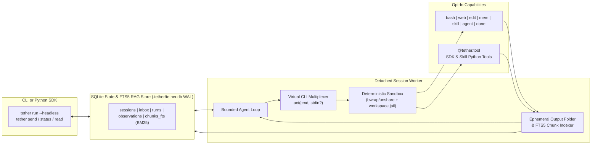
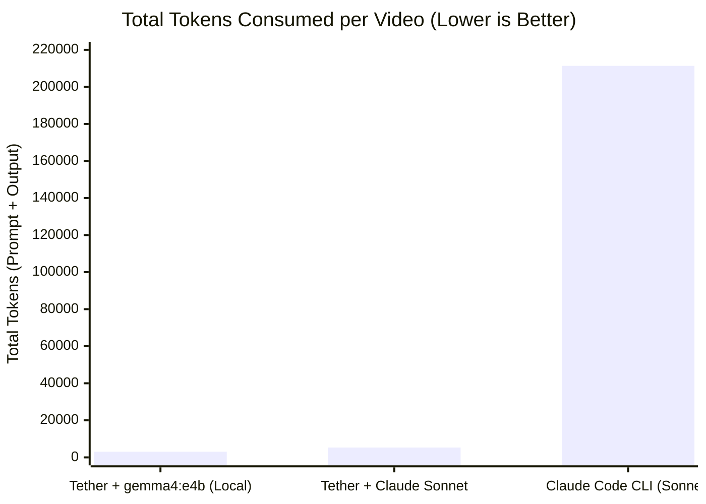
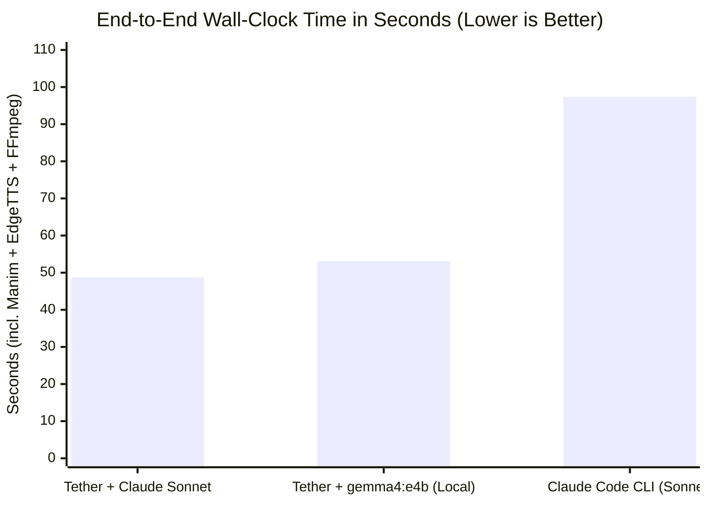

# 🪢 Tether

**A general-purpose, headless-first LLM-Native micro-harness engineered for small context windows and high-signal business logic.**

[-6366f1)](#theoretical-foundation)
[%20%7C%20Claude%20%7C%20GPT-10b981)](#multi-model-zero-bloat-adapters)
[](#quickstart)

---

## Why Tether?

Modern agent frameworks treat context windows as infinite dumping grounds. Before your application processes a single line of business logic, typical harnesses inject **3,000–8,000+ tokens** of verbose JSON tool schemas, sprawling system prompts, and unpruned execution traces.

On frontier cloud models, that waste is expensive. On local and small models like **`qwen3.5:9b`**, it is fatal:
1. **Attention Dilution:** Flooding the prompt with dozens of unused tool schemas degrades reasoning accuracy on the actual domain task.
2. **Structured-Output Fragility:** Small models frequently hallucinate escaping or nested JSON structures when forced to choose among 20+ complex function-calling schemas.
3. **KV-Cache Thrashing:** Dynamically mutating the `tools` array between turns invalidates prefix caches in local inference servers (`Ollama`, `llama.cpp`, `vLLM`), tanking latency.

**Tether** keeps your LLM, tools, skills, and sub-agents tied together with near-zero overhead—starting with **zero tools loaded by default** and reserving **>90% of the active context window** for your domain problem.

---

## Theoretical Foundation

Tether is not just another wrapper around chat completions; every design choice is grounded in recent systems and software-architecture research on why LLM agents succeed or fail:

1. **Probabilistic Core, Deterministic Envelope ([Maia et al., 2026](#references)):**
   Rather than trusting the model to enforce its own guardrails or manage state in raw text, Tether separates the **probabilistic reasoning kernel** (the LLM) from a **strictly deterministic envelope** (CLI argument parsing, path canonicalization, OS kernel sandboxing, SQLite ACID state transitions, and explicit `done` termination gates).
2. **Why a Single `act(cmd, stdin)` Primitive Beats 30 JSON Schemas ([Wang et al., ICML 2024 — *CodeAct*](#references)):**
   Across 17 evaluated models, Wang et al. demonstrated that forcing an LLM to choose among dozens of rigid JSON function-calling schemas degrades reasoning and wastes thousands of prompt tokens. Consolidating actions into a **single unified executable action channel** improves task success rates by **up to 20%** while cutting required turns by **~30%**—an effect that is especially pronounced on smaller open-weight models (`7B`–`9B`).
3. **Why a Virtual CLI + Progressive `--help` + Observation Folding ([Yang et al., NeurIPS 2024 — *SWE-agent*](#references)):**
   Just as humans need ergonomic UIs, LLMs need purpose-built **Agent-Computer Interfaces (ACIs)**. Following Yang et al., Tether replaces raw shell dumps and upfront schema walls with a compact POSIX-style command bus, windowed line-numbered file editing (`edit view`/`replace`), immediate self-healing usage hints (`--help`) when a command is malformed, and **ephemeral observation folding** so old tool outputs don't crowd out active reasoning.
4. **Context as L1 Cache Backed by SQLite L2 Storage ([Packer et al., 2023 — *MemGPT*](#references)):**
   Instead of treating the prompt as an unbounded append-only transcript, Tether treats the active context window like an **OS L1 working cache** (static prefix + `mem pin` scratchpad + the last $K$ raw observations) backed by **L2 disk storage** (`.tether/tether.db` in WAL mode with an automatic FTS5 BM25 index), allowing agents to page relevant knowledge in and out on demand via `mem search`, `mem recall`, and `agent query`.

---

## Core Pillars of Tether `v0`

### 1. Virtual CLI Multiplexer + Progressive `--help`
Instead of registering dozens of JSON schemas with the model provider, Tether exposes **only one static JSON tool** (`act(cmd: str, stdin: str | None = None)`) and routes all capabilities through a virtual POSIX-style command bus:
- **Zero Tools by Default:** Start completely bare (`done` only), or opt-in to specific tools via CLI (`--tools web,bash` or `--tools all`), Python SDK (`tools=["web"]`), or Skill frontmatter.
- **1-Line Toolbox Index:** Active tools appear as a compact 1-line summary in the static prompt prefix (~10 tokens per tool).
- **JIT Schema Disclosure (`--help`):** Full flags and docstrings are disclosed only when the model runs `<cmd> --help` or makes an argument error (self-healing usage hint).
- **Explicit Termination (`act("done", stdin="...")`):** Small models often think out loud mid-task. Rather than prematurely ending the session on an un-tooled text reply, Tether requires an explicit `act("done", stdin="final report")` call to lock in the final deliverable.



### 2. Headless-First Sessions & Live SQLite Inbox
Every Tether execution is a stateful session persisted in `.tether/tether.db` (SQLite WAL mode). You can run sessions inline or spawn detached background workers (`--headless`):
- **Live Inbox & Auto-Resume:** Calling `tether send <session_id> "new instruction"` checks the session state in SQLite:
  - If **`RUNNING`**: queues the message into the session's SQLite inbox, which the worker injects before the next reasoning step.
  - If **`COMPLETED` / `IDLE`**: appends the message and automatically spawns a worker to resume the session with its pinned memory and folded context intact.

### 3. Progressive Skills (`skills/`)
Skills are portable capability bundles stored in `./skills/<name>/SKILL.md` (or `./skills/<name>.md`) with YAML frontmatter and an optional sibling `tools.py`:
```markdown
---
name: researcher
description: Deep web research and synthesis specialist
model: ollama/qwen3.5:9b
tools: [web, mem, done]
---
You are a focused research agent. Search multiple sources via `web search`,
fetch key articles with `web fetch`, pin verified facts with `mem pin`,
and conclude with `act("done", stdin="<markdown report>")`.
```

### 4. Async Multi-Agent Orchestration & Zero-Bloat SQLite FTS5 RAG
Because every Tether session is headless-capable, a parent agent can delegate context-heavy subtasks to child agents with isolated context windows—**without drowning when reading their results back**:
- `agent spawn --skill researcher "Summarize AI news"` $\rightarrow$ immediately returns `ses_9a2f1c` (non-blocking).
- `agent wait ses_9a2f1c ses_4b8e0d` $\rightarrow$ returns a **compact ~50-token digest** (status, chunk count, preview) rather than dumping thousands of tokens into the parent's prompt.
- `agent query ses_9a2f1c "open-weight benchmarks" --top 3` $\rightarrow$ uses **SQLite FTS5 (BM25 ranking)** over the sub-agent's chunked final deliverable *and* raw scraped observations to retrieve only the top-K relevant snippets (~250 tokens). Pass `--all` to search across all child sessions at once!
- `mem search "rate limits"` $\rightarrow$ uses the same FTS5 index inside a single session to pull specific chunks from folded observations without recalling the entire raw output.

### 5. Deterministic Security Sandbox (Never Relying on the LLM)
In line with Maia et al. (2026), safety boundaries are enforced **deterministically by the harness and OS kernel**, never by prompting the model to "be careful":
- **Default `workspace-write` Jail:** Every `edit` and `bash` path is canonicalized (`realpath`) and confined to the workspace root. Sensitive paths (`.env*`, `.git/config`, `.git/hooks`, `~/.ssh`, `.tether/`) are deterministically blocked from mutation or exfiltration.
- **OS-Level Kernel Sandbox for `bash`:** On Linux, Tether automatically wraps shell commands in **`bwrap` (Bubblewrap) / `unshare`** when available—mounting `/` read-only, hiding `$HOME` with an empty tmpfs, binding only the workspace directory, and setting `PR_SET_NO_NEW_PRIVS`. When kernel sandboxing is unavailable, Tether enforces a strict deterministic binary allowlist/denylist.
- **Secret Environment Scrubbing & Resource Caps:** Subprocesses run with a scrubbed environment (`OPENAI_API_KEY`, `ANTHROPIC_API_KEY`, `GITHUB_TOKEN`, `AWS_*` stripped), hard process-group timeouts (`SIGKILL`), and output byte caps.
- **Privilege Attenuation:** Child sub-agents spawned via `agent spawn` strictly inherit (or narrow) their parent session's sandbox profile and can never escalate permissions.

### 6. Multi-Model, Zero-Bloat Adapters
Tether supports any local or cloud model through **3 ultra-thin `httpx` adapters** (<200 LOC total, zero heavy SDK dependencies):
- **`ollama/<model>`** — Native Ollama `/api/chat` adapter with `num_ctx` and `keep_alive` control (e.g., `ollama/qwen3.5:9b`).
- **`openai/<model>`** — OpenAI-compatible `/v1/chat/completions` adapter (OpenAI, OpenRouter, vLLM, llama.cpp, Groq, DeepSeek).
- **`anthropic/<model>`** — Native Anthropic `/v1/messages` adapter for Claude models.

---

## Real-World Benchmark: Autonomous YouTube Short Production

To measure how harness architecture impacts token consumption, latency, and local-model viability, we ran a head-to-head benchmark across **three configurations** (2 trials each) on a multi-stage media task:

> **Task:** *"Create a 30-to-40 second vertical YouTube Short (1080x1920 `.mp4`) explaining 'What is an AI Harness, the Context Bloat Problem, and Micro-Harnesses', complete with 4 animated **Manim** vector diagrams, **EdgeTTS** neural voiceover (`en-US-ChristopherNeural`), synchronized subtitles, and **FFmpeg** muxing."*

### Results Summary (2-Trial Averages)

| Configuration | Harness | Model | Avg Steps | Avg Total Tokens | Peak Context | Avg Wall Time | Token Reduction vs. Claude Code |
| :--- | :--- | :--- | :---: | :---: | :---: | :---: | :---: |
| **Tether + Local 8B** | **Tether `v0`** | `ollama/gemma4:e4b` | **2.0** | **3,073** | **1,854** | **53.1s** | **68.8× fewer tokens** (\$0 local) |
| **Tether + Claude** | **Tether `v0`** | `anthropic/claude-sonnet-5-5` | **2.0** | **5,318** | **3,118** | **48.7s** | **39.7× fewer tokens** (2.0× faster) |
| **Claude Code CLI** | Claude Code | `claude-sonnet-5-5` | 5.0 | 211,355 | 42,091 | 97.4s | 1.0× (baseline) |





### Why the 40×–69× Token Difference?
1. **Zero Tool Schema Bloat:** Claude Code injects **~41,000+ tokens** of system instructions and JSON tool schemas on *every single reasoning turn* (consuming `164k–257k` cumulative tokens across 4–6 turns of file exploration and shell execution). Tether's static prefix + `shorts-maker` skill framing is **< 400 tokens**, allowing both `claude-sonnet-5-5` and a local `8B` model (`gemma4:e4b`) to one-shot the entire 4-scene YAML specification via `act("render-short ...", stdin="...")` on Turn 1 and call `done` on Turn 2.
2. **Identical Frontier Model, 39.7× Less Context:** Running the *exact same* `claude-sonnet-5-5` model inside Tether instead of Claude Code cut token consumption from **211,355 $\rightarrow$ 5,318 tokens** and halved execution time (**97.4s $\rightarrow$ 48.7s**), because nearly 100% of wall-clock time went to actual Manim + EdgeTTS rendering (~43s) rather than re-processing massive prompt prefixes.

---

## Quickstart

### Headless CLI Usage

```bash
# 1. Start a headless background session with the 'researcher' skill
$ tether run --headless --skill researcher "What are the latest news about AI?"
ses_8f92a1

# 2. Or start with explicit opt-in tools and any model
$ tether run --headless --model ollama/qwen3.5:9b --tools web,mem "Compare vLLM vs Ollama"
ses_3c71b9

# 3. Check live session status, step count, and token budget
$ tether status ses_8f92a1
ID          STATUS     MODEL              STEP   CTX_TOKENS   LAST_CMD
ses_8f92a1  RUNNING    ollama/qwen3.5:9b  3/15   580/8192     web search "AI news 2026"

# 4. Read the final report (or --steps to inspect the work log)
$ tether read ses_8f92a1

# 5. Send a follow-up (queues into live inbox if RUNNING, or auto-resumes if COMPLETED)
$ tether send ses_8f92a1 --headless "Now spawn a sub-agent to fact-check the top 2 announcements."
```

### Python SDK Usage

```python
import asyncio
from tether import Harness, tool


@tool(name="crm", description="Query or update customer subscription tiers")
async def crm(customer_id: int, tier: str = "pro") -> str:
    """Update customer tier. Allowed tiers: free, pro, enterprise."""
    return f"Customer #{customer_id} updated to {tier}."


async def main():
    # Minimal by default: only loads `done` + explicitly requested tools
    harness = Harness(
        model="ollama/qwen3.5:9b",
        tools=["mem", crm],
        fold_observations_after=2,
    )

    session = await harness.run(
        "Upgrade customer 1042 to enterprise, pin the audit note, and finish."
    )
    print(f"Session {session.id} [{session.status}]:\n{session.result}")


if __name__ == "__main__":
    asyncio.run(main())
```

### Custom SDK Provider Routing (`register_provider` / `provider=...`)

Want to route Tether through a custom transport—such as an internal corporate gateway, a custom local inference server, or a mock/replay harness for testing? Implement the 1-method `ModelProvider` protocol or register a custom URL prefix with `register_provider`:

```python
import httpx
from tether import (
    Harness,
    ModelResponse,
    extract_fallback_action,
    register_provider,
)


class CustomGatewayProvider:
    """Routes Tether turns through a custom internal LLM gateway."""

    def __init__(self, model_name: str) -> None:
        self.model_name = model_name

    async def generate(self, messages: list[dict], tools: list[dict]) -> ModelResponse:
        async with httpx.AsyncClient(timeout=60.0) as client:
            resp = await client.post(
                "https://llm-gateway.internal/v1/generate",
                json={"model": self.model_name, "messages": messages, "tools": tools},
            )
            data = resp.json()
        text = str(data.get("text") or "").strip()
        return ModelResponse(
            content=text,
            action=extract_fallback_action(text),
            prompt_tokens=int(data.get("total_tokens") or 0),
        )


# Register as a custom `<prefix>/<model>` for Harness, Skills, and Sub-Agents:
register_provider("gateway", CustomGatewayProvider)

harness = Harness(model="gateway/qwen-enterprise-32b", tools=["web", "mem"])
```

---

## Built-In Virtual CLI Toolbox (Opt-In)

| Namespace | Subcommands | Description |
| :--- | :--- | :--- |
| **`done`** *(always on)* | `done [summary]` *(or via `stdin`)* | Explicitly complete the current task and record + FTS5-index the final deliverable |
| **`web`** | `web search <query>` \| `web fetch <url>` | Zero-config DuckDuckGo Lite search (auto-upgrades to Brave/Tavily/SearXNG) + clean reader |
| **`bash`** | `bash <command>` *(or script via `stdin`)* | Kernel-sandboxed (`bwrap`/`unshare`), env-scrubbed, workspace-bounded shell execution |
| **`edit`** | `edit view <path>` \| `edit write <path>` \| `edit replace <path>` | Workspace-jailed, line-numbered file viewing and `stdin`-based creation/replacement |
| **`mem`** | `mem pin <k> <v>` \| `mem search <query>` \| `mem recall <obs_id>` | Pinned working memory + BM25 RAG search & retrieval over folded observations |
| **`skill`** | `skill list` \| `skill load <name>` | Progressive discovery and JIT loading of skill instructions & tools |
| **`agent`** | `agent spawn` \| `agent wait` \| `agent query` \| `agent read` \| `agent send` | Async sub-agent spawning, compact wait digests, and BM25 RAG queries over child sessions |

---

## Project Structure

```text
tether/
├── README.md
├── AGENTS.md                  # Authoritative blueprint for coding agents & contributors
├── mkdocs.yml                 # MkDocs Material documentation configuration
├── pyproject.toml             # Managed with uv (httpx, pyyaml, standard library)
├── docs/                      # Full documentation, tutorials & API reference
├── skills/                    # Built-in & workspace progressive skills
├── tether/
│   ├── __init__.py            # SDK exports: Harness, Session, Skill, SandboxPolicy, tool
│   ├── cli.py                 # `tether` CLI entrypoint (run, status, read, send, list)
│   ├── harness.py             # Control Plane: bounded agent loop, inbox polling, worker spawn
│   ├── store.py               # State & RAG Plane: SQLite WAL + FTS5 BM25 chunk store
│   ├── sandbox.py             # Security Plane: bwrap/unshare kernel sandbox & workspace jail
│   ├── multiplexer.py         # Action Plane: `act(cmd, stdin)` parser, router & JIT --help
│   ├── decorator.py           # `@tool` introspection -> POSIX CLI parser & compact usage
│   ├── context.py             # State Plane: ContextAssembler & Ephemeral Observation Folder
│   ├── skills.py              # Markdown + YAML frontmatter + companion `tools.py` loader
│   ├── providers/             # Thin httpx adapters: ollama.py, openai.py, anthropic.py
│   └── tools/                 # Opt-in built-ins: bash.py, web.py, edit.py, mem.py, agent.py
└── tests/                     # Per-module unit tests + integration suite (100% coverage)
```

---

## References

1. **Maia, P. H. M., et al. (2026).** *LLM-Native Applications as a Paradigm for AI-Driven Software Architecture*.
2. **Wang, X., Chen, Y., Yuan, L., Zhang, Y., Li, Y., Peng, H., & Ji, H. (2024).** *Executable Code Actions Elicit Better LLM Agents (CodeAct)*. In **Proceedings of the 41st International Conference on Machine Learning (ICML 2024)**. [arXiv:2402.01030](https://arxiv.org/abs/2402.01030)
3. **Yang, J., Jimenez, C. E., Wettig, A., Lieret, K., Yao, S., Narasimhan, K., & Press, O. (2024).** *SWE-agent: Agent-Computer Interfaces Enable Automated Software Engineering*. In **Advances in Neural Information Processing Systems (NeurIPS 2024)**. [arXiv:2405.15793](https://arxiv.org/abs/2405.15793)
4. **Packer, C., Wooders, S., Lin, K., Fang, V., Patil, S. G., Stoica, I., & Gonzalez, J. E. (2023).** *MemGPT: Towards LLMs as Operating Systems*. [arXiv:2310.08560](https://arxiv.org/abs/2310.08560)
