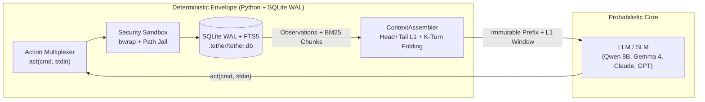

# Architecture

*For: contributors and agents changing tether, and anyone who wants to know why it works the way it does. This page is the source of truth: the decisions below are binding, the open questions are not decided yet, and the research section explains the evidence behind them.*

Most agent frameworks were designed around massive frontier models with 200k-token context windows. When you point those same frameworks at a local 8B or 9B model (`ollama/qwen3.5:9b`, `ollama/gemma4:e4b`), they immediately fail—not because the model cannot reason, but because **3,000 to 8,000 tokens of nested JSON tool schemas and raw tool outputs** flood the attention window before the agent takes its second step.

Tether's design translates four foundational works in recent AI systems research into a compact, zero-bloat Python micro-harness.



---

## How to read and change this page

This page is the **single source of truth for tether's architecture**. A decision here is binding: code, tests and docs follow it, and a change that contradicts one is rejected or reworked until the decision itself is changed on purpose.

- **Contributors and agents** read the decisions that touch their change before writing code, and cite the ID (`AD-12`) in the PR.
- **Changing a decision** happens only when the product owner asks for it. The change edits the entry in this page (what, why, what it costs, status) in the same PR as the code, never one without the other.
- **A new decision** (a constant, a default, a trade-off, a rejected alternative) is added here in the PR that introduces it. If it is not here, it is not decided.
- **An open question** stays in [Open questions](#open-questions) until the product owner decides it; then it moves to the register as a decision, or to [Not adopted](#not-adopted-and-why) with its evidence.

Each entry has the same shape: the **decision**, the **why**, and what it **costs** or where its limit is. Issue numbers (`#173`) point to GitHub for the full discussion.

---

## Decisions

### A. Product principles

**AD-1. One action primitive: `act(cmd, stdin)`.** The model sees a single JSON tool; every built-in and `@tool` is a command in a POSIX-like grammar behind it. *Why:* small models hallucinate nested JSON keys and pick the wrong schema among many (CodeAct). *Cost:* a command grammar to normalise (AD-30).

**AD-2. Zero optional tools by default.** Only `done` is on. `bash`, `edit`, `web`, `mem`, `agent` are opted in per run (`--tools`, SDK, skill). A skill's own `tools.py` functions are opt-in too (unlisted ones warn, 0 prompt tokens). *Why:* every enabled tool costs prompt tokens on every turn, and an unused tool is also an attack surface.

**AD-3. The static prefix never changes mid-session.** No edit to the system prompt or the `tools` array after step 1; pins go on the tail message; history is replayed byte-identical. *Why:* KV-cache reuse needs an exact prefix match (Ollama, llama.cpp, vLLM, Anthropic and OpenAI caching). Fixed framing stays under 150 tokens, asserted by a test.

**AD-4. Probabilistic core, deterministic envelope.** The model decides the next command; routing, argument parsing, folding, stall detection, SQLite transitions, sandboxing and completion are Python. *Why:* safety and reliability must not depend on a model obeying a prompt. Anything new that the harness can decide without a model call is decided without one (0 static prompt tokens, no extra model call).

**AD-5. Philosophy gate.** Every change is judged against: lightweight, token saver, reliable, extensible, model-agnostic, easy to use, resourceful. No behaviour tied to one vendor or model; small local models and frontier models share one code path. New behaviour arrives through providers, skills, `@tool` or config, not special cases in the harness core.

**AD-6. Dependencies stay minimal.** Stdlib plus `httpx` and `pyyaml`. No framework or vendor SDK (`langchain`, `litellm`, `openai`, `anthropic`, ...). The official `mcp` SDK is allowed only as the optional `tether-sdk[mcp]` extra, imported lazily.

**AD-7. The North Star ranks everything.** The one number is Polyglot-Python pass rate on `ollama/qwen3.5:9b`, default config, full 34 exercises x 2 runs (74% by v0.4.0). Two lanes are tracked: the general-purpose default (official) and the shipped `swe` role (never below the default). Every stronger model must score at least what the weakest scores. Other indicators may slow but not degrade between releases. *Why:* a weak model is where harness quality shows; a harness that only works for frontier models is not the product.

### B. State and sessions

**AD-8. SQLite (WAL) with FTS5 is the only state store.** `.tether/tether.db`: sessions, turns, observations, pins, inbox, snapshots, FTS5 chunks. Connections are cached per thread with `synchronous=NORMAL`, `temp_store=MEMORY`, `mmap_size=128 MiB`. *Why:* ACID, zero service to run, BM25 retrieval for free. *Cost:* one writer; sessions share a file.

**AD-9. Context is bounded working memory, never an append-only transcript.** Everything is stored in full; what the model sees is assembled (AD-14). Recall is explicit (`mem recall`, `mem search`, `agent query`).

**AD-10. Sessions are rows plus a detached worker.** `tether run --headless` writes the row and spawns `python -m tether.cli _worker <id>` in its own session. IDs are `ses_` plus 8 hex chars. A `RUNNING` or `PENDING` session whose stored `pid` is gone is reaped to `FAILED` when read. The headless worker never imports a `tether` package from the workspace and drops empty or relative `PYTHONPATH` entries (a workspace must not be able to run code in the harness).

**AD-11. A session never silently dies or hangs.** Outcomes are `COMPLETED`, `FAILED` or `WAITING_INPUT`. Running out of steps, tokens or patience (stuck) *hands the task back* as `WAITING_INPUT` (exit 2) with a summary, so the caller can `send` a refined request; `send` extends `max_steps` to `step_count + budget` so the ceiling is absolute. `max_tokens` is optional and pauses the same way. Ctrl+C stops a foreground run cleanly (exit 130, session handed back).

**AD-12. Changes are tracked by looking at the workspace, not at the command text.** Files are compared before and after each command (`workspace.py`): the first bytes a session saw of each changed file are snapshotted (256 kB each) for `tether diff`. Ceilings (50,000 entries, 32 MB cache) are limits, not tuned values.

### C. Context assembly

**AD-13. Token counting is a deliberate approximation.** `estimate_tokens` is `(chars + 3) // 4`, scaled by a per-provider calibration. The prompt budget is 3/4 of `max_context_tokens`; the rest is room for the reply. *Why:* no tokenizer dependency (AD-6), one estimator for every model.

**AD-14. Folding is as-needed, oldest first.** Nothing folds by age while the history fits in half of `max_context_tokens`. Above that, observations older than K=2 turns fold into a one-line tombstone, only until the history is back under the target. Any unedited re-read lengthens K by one (cap 8). An explicit `--fold-after N` keeps the fixed rule. The latest read of each of the last 8 files stays live until the file changes or is re-read. *Why:* folding too early made models re-read the same file in loops; folding never blows the window.

**AD-15. One observation may use up to a third of the window.** The cap is `max(2400, max_context_tokens * 4 / 3)` characters, with head + tail elision (first 60%, last 40%, pointer to `mem recall`). A fixed 2,400-char cap cut 6-12 KB test files and caused re-read loops. A cut test file is indexed by its test names so the model can ask for one.

**AD-16. History is replayed as structured tool calls** for providers that support them (`structured_history`); `stdin` is replayed as a real 400-char prefix, never as a placeholder. A call and its result are trimmed together.

**AD-17. Default context is 32,768 tokens.** The biggest window the typical setup runs fully on GPU (`qwen3.5:9b` stays 100% on an 8 GB card at 32k; 64k spills). It is the default for local providers; an explicit argument or a `providers.yaml` key wins. Paid APIs keep a window as small as the task needs unless configured otherwise (see OQ-4).

**AD-18. Pins and notices cost nothing static.** Nudges, notes and hints are appended to the observation of the step they concern, never to the prefix, and each has a character bound and a unit test.

### D. The loop

**AD-19. A task ends only with `done`.** Plain text without a command never completes a session; the harness nudges. A reply of 80 or more characters may be the answer: the nudge says it was not delivered, and a session that ends stuck carries it in its result, marked "never confirmed with `done`". `done --ask` pauses for input. A bare `done` completes with `Done.`.

**AD-20. Quiet-step nudges are deterministic and sparse.** After a change, 6 read-only steps then every 8 more add a `[NUDGE]` to call `done`; before any change, 12 then every 8 more ask for the edit. Lookups by built-in tools count as reads. *Why:* a 9B model does not know it is finished; the harness does.

**AD-21. Stalls escalate in fixed stages, then restart, then hand back.** Identical repeats, 2- to 4-command cycles and 7 reads of one file with no change are stalls; 4 unanswered warnings first get one `[WRAP UP]` turn. Being stuck restarts the session at most twice (the history continues from one `restart` turn of at most 6,000 chars; failed commands are not replayed), then the task is handed back. When the same check fails 3 times with edits in between, the changed files go back to how they started and the message names the failing tests, not the failed code. A near pass (at most 3 failing, more than twice that passing) is kept and restored in place if later edits do not beat it. *Why:* a fresh attempt beats repairing a wrong one on weak models (Olausson et al.).

**AD-22. Completion is verified by the deterministic gate, not by the model.** With `verify` gates, `done` runs them inside the session's sandbox (own timeout, 300 s by default, `TETHER_GATE_TIMEOUT`); a failing gate rejects `done`. A gate that errors instead of failing (sandbox violation, exit 124/126/127) ends the session `FAILED` as `gate_error`. Gates are pre-checked before the first model call (empty, unparsable, missing program: no tokens spent). When a session stalls with a change and every gate passes, it ends `COMPLETED` ("Finished by the harness"). With no gates, the model's own last passing test run (still green when re-run) is the implicit gate. A model's `done` is not evidence; a gate is.

**AD-23. When steps run out, ask once for the answer.** One last answer-only model call (no tools for Ollama, `tool_choice: none` elsewhere) leads the hand-back summary; a command in it is never run.

**AD-24. The repair loop around tests spends harness time, not model time.** After the model first runs a recognised test command: the harness re-runs it after each write (`[auto-test]`), appends failing test source (up to 3 functions, 1,500 chars), a regression line, a runtime trace of the smallest failing test (30 lines, 1,500 chars, 2 levels), names a rewrite that changed nothing, points a near-total rewrite to `edit replace`, and undoes a `bash` command that left a `.py` file unparsable (`[REVERTED]`). A test run piped to `head` runs without the pipe and keeps its summary and exit code. *Why:* typing code is where a small model spends its time; the checks are free.

**AD-25. Stats show whether notices work.** `tether stats` reports, per notice that asks the model to act, how often it fired and how often the next step complied. A notice that is ignored is removed, not reworded.

### E. Providers

**AD-26. Three thin `httpx` adapters plus a declarative layer.** Native Ollama, OpenAI-compatible (GPT, vLLM, Groq, OpenRouter) and native Anthropic; `~/.tether/providers.yaml` maps a model prefix to a kind (`openai`, `ollama`, `anthropic`, `command`). The file is never read from the workspace (a cloned repo cannot plant a provider); keys are env var *names*, never values; built-in prefixes cannot be shadowed; `command` runs `argv` directly, never through a shell. Without a prefix the model is `ollama/<model>`.

**AD-27. Provider failures retry, then name themselves.** Timeouts, network errors, 429 and 5xx retry twice (1 s, 2 s backoff); each attempt has a total deadline. Defaults: 120 s OpenAI-compatible, 300 s Ollama, 180 s Anthropic, 300 s command. A failure names provider, model and timeout; a 401/403 names the missing variable, never its value; a usage limit fails once with the provider's own words. A tool call a provider rejects (malformed arguments) becomes a hint to the model, not a crash. A model missing on Ollama fails loudly with the installed list (`TETHER_OLLAMA_FALLBACK=1` opts in to substitution). `rpm` caps requests per minute with a lock file shared across processes.

**AD-28. Sampling is left to the model.** No forced temperature or top-p; a caller's `params` win. A forced `temperature 0.2` doubled runaway-thinking turns on `qwen3.5:9b`.

**AD-29. Thinking is bounded.** `think=false` when under 3,072 tokens of the window are free; a thinking turn gets `num_predict` 2,560 and, when cut with no command or a half tool call, is asked once more with thinking off. Thinking is stored (`tether read --thinking`) and never sent back to the model. Anthropic marks the static system prompt and the `act` schema with `cache_control: ephemeral`.

### F. The action layer

**AD-30. Quirks are normalised before they fail.** The multiplexer fixes trivial syntax mistakes deterministically (leading `$`, backticks, `bash -c` wrappers, heredocs into `stdin`, `edit --file/--content`, `act(...)` typed as text, a native tool named other than `act`, `apply_patch` shapes, `sed -n 'a,bp file'`, plain shell writes as `edit` when `bash` is off, unknown first words run through `bash` when enabled). Extra fixers register with `register_normalizer`. An unknown or invalid command returns a self-healing usage hint, never a Python exception; a disabled built-in says it is disabled and how to enable it.

**AD-31. Help is progressive.** One line per enabled tool (at most 12 tokens) in the prompt; full usage (at most 60 tokens) only on `--help` or on a malformed call.

**AD-32. `edit` is the safe write path.** `view`, `write`, `append`, `insert`, `replace` and SEARCH/REPLACE blocks, jailed to the workspace; a write that would wipe a file or delete lines says so. Multiline payloads travel in `stdin`, never inside a shell-escaped `cmd`.

**AD-33. Tool output is compact by construction.** `bash` strips the workspace prefix and rule lines, collapses long Python tracebacks, says why a command with a background job timed out, and every failure ends with what to do next.

### G. Security

**AD-34. The jail is the kernel, not the prompt.** Default profile `workspace-write`: paths canonicalised and confined to the workspace; secret-looking files (`.env*`, `*.pem`, `*.key`), `.tether/`, `.git/config` and `.git/hooks` masked at the mount level and read as empty rather than denied; an allow-listed environment only (secrets with any name dropped; `TETHER_ENV_PASSTHROUGH` opts in); `web fetch` blocks loopback, private and metadata addresses.

**AD-35. `bwrap` or fail closed.** On Linux `bash` runs in Bubblewrap (read-only `/`, `/home` hidden, `/run` sockets masked, `PR_SET_NO_NEW_PRIVS`), falling back to a deterministic command allow/deny list only when the caller opts out (`--allow-unsandboxed`, `allow_unsandboxed=True`, `TETHER_SANDBOX=container`). Without `bwrap`, write sessions refuse to run. `tether doctor` tells a missing `bwrap` from one the kernel blocks.

**AD-36. Authority only narrows, with two named exceptions.** Child sessions, pipeline stages and MCP callers may restrict the sandbox, never widen it. The exceptions (`allow_unsandboxed`, `allow`) exist only on an MCP server started with `--permit-widen`.

**AD-37. Escalation is by the caller's approval.** Commands outside the jail run only from an allowlist (`--allow`, `.tether/allow.json`) matched by whole tokens with no shell. A command whose prefix is in `SandboxPolicy.escalate` (default `git push|pull|fetch|clone|worktree|config`, `gh`, `docker`) and not allowlisted pauses the session `[APPROVAL NEEDED]`; only the caller approves (never a model's `agent send`). Never offered with metacharacters, unsafe git options, read-only or no-network sessions.

**AD-38. Every refusal says the rule, an alternative and the flag.** A refused command is not a change; sandbox refusals are recorded as `sandbox_violation` events with the rule name and shown in `tether stats`. Resource limits (`--limit cpu mem procs fsize`) are off by default, Linux only, and a hit appends a labelled line.

**AD-39. The model never gets git.** `tether run --worktree` creates the branch and commits the result; only harness code runs git.

### H. Multi-agent and interfaces

**AD-40. Sub-agents are always asynchronous.** `agent spawn` returns an id at once; `wait` returns a ~50-token digest; `query` returns the top-K BM25 chunks; the parent's context is never flooded. Sub-agents share the database and inherit or narrow the sandbox.

**AD-41. Pipelines are deterministic.** Each stage is its own session with its own model, gates and a narrowed sandbox; downstream stages get a digest of upstream stages plus `agent query`/`read`; `--resume` re-runs from the first stage not `COMPLETED`.

**AD-42. The agent interface is JSON with a versioned schema.** `--json` (schema `v: 1`), exit codes `0` completed, `1` usage, `2` waiting, `3` gate, `5` worker error, `6` wait timed out, `130` interrupted; failure text on stderr; a foreground run prints `session ses_<id>` to stderr at creation. `tether mcp` serves the same JSON over stdio, rooted at `--workspace`.

**AD-43. Learning from failure is offline.** `tether retro` distils at most two learned rules from a friction trace and prints a diff; nothing changes a live prompt, and `--apply` is required to write.

### I. Process and quality

**AD-44. Two audiences, two documents.** The docs site is for people who use tether and the agents that integrate it: plain language, one canonical page per topic, no bug history, known problems link to a `known-issue` GitHub issue. The README is for people evaluating, building on or contributing to tether. This page is for contributors and agents.

**AD-45. Behaviour the model sees is locked by golden traces.** Framing, folding, nudges and tool output are snapshotted in `tests/golden/`; a PR that changes them updates the snapshot and the diff is part of the review. Coverage is 100%, enforced in CI.

**AD-46. Real-model behaviour is tested locally, not in CI.** `e2e/` runs the real CLI against Ollama behind a fault-injecting proxy and asserts on what tether sends and records, never on model skill. It runs before every merge and its result goes in the PR; every failure is mitigated or explained.

**AD-47. Delivery.** One PR per task, Conventional Commits, squash-merged to `main`, docs in the same PR. Force pushes, history rewrites, merges and releases need the product owner's explicit yes each time; PyPI is published only from a GitHub Release. Every PR states how it moves the North Star (`north star: before -> after`).

**AD-48. Measure before you build, and decide fast.** Offline replay and determinism checks decide first; only a change that moves its target metric gets GPU time. Comparisons are paired (same exercises, seeded), with a stated power and minimum detectable difference; no n=1 comparisons; the wall-cap is not part of the North Star. Never bench per line of code. Every bench end is reported at once.

**AD-49. Work is split into cards a small model can finish.** One file, about 15 lines, one edit per card, exact brief and a pinned failing test; 2-file cards and documentation rewrites by small models loop or invent facts. A minion's `done` is not evidence: every requested fix is pinned by a failing test used as the gate, and gates run inside the sandbox.

---

## Open questions

Each is a question the product owner has not decided. Until one is decided, code keeps the behaviour described here.

| ID | Question | Where it stands |
|---|---|---|
| OQ-1 | **How do we get a weak model to revise a wrong first design?** | The dominant `qwen3.5:9b` failure is a misread spec at about step 4, never revised; repairs are whole-file rewrites (354 rewrites, 0 targeted edits in the analysed runs). Loop and nudge changes were flat. A rollback/best-version gate (Huang et al.) is only partly in place (the near-pass restore, AD-21). |
| OQ-2 | **Should the Ollama context be probed per host and model?** | Today 32,768 is a fixed default (AD-17). An idea: probe 32k/64k/128k once, capped at the model's `context_length`, and keep the largest that stays 100% on GPU. Not built; explicit values would still win. |
| OQ-3 | **Should thinking tokens be capped separately from the reply?** | Total `num_predict` is capped at 2,560 (AD-29). Streaming and capping only the thinking part (about 1,500) would save time on runaway turns; not done. |
| OQ-4 | **What window is right for paid models?** | Billed per token, so small is cheaper, but folding rewrites old messages and may break prompt caching. Haiku at 8k vs 32k, billed tokens including cache reads, has not been measured. |
| OQ-5 | **How should repeated reads (63% of steps are reads, 24% repeats) be cut?** | `live_read` pointers and the pre-change nudge exist; the share of repeat reads after them has not been measured with paired seeds. |
| OQ-6 | **What about the "unsaid cases" tier of the Coding Ladder (#200)?** | Every local model fails it; no lever found. |
| OQ-7 | **What is the `swe` role's own target?** | Reported next to the default and never below it (AD-7); a target waits for its baseline to be pinned (#172). |
| OQ-8 | **Is a stronger sandbox than `bwrap` needed?** | On hosts where the kernel blocks unprivileged user namespaces `bwrap` does not run; the fallback is unsandboxed or a container. No third option exists. |
| OQ-9 | **Which pending hardening is worth its cost?** | `web fetch` resolves then connects, leaving a DNS-rebinding window; a CPU-limit hit by a trapped `SIGXCPU` is unlabelled; the change tracker disables itself above its entry ceiling. Each is a documented ceiling, not a decision to ignore. |
| OQ-10 | **Do we ship a public benchmark harness (#123)?** | Blocked on a docker firewall and a key; the in-repo `bench/` stays the source of truth. |
| OQ-11 | **Should the e2e suite run in CI?** | It needs a GPU-backed Ollama, so it is local only (AD-46); a self-hosted runner is not planned. |
| OQ-12 | **What happens to the 7 exercises that never pass?** | bowling, forth, react, rest-api, scale-generator, sgf-parsing and transpose are not planned for; revisit only if the other 27 reach their target. |
| OQ-13 | **How do small models write long documentation?** | They invent API facts when rewriting a page; docs by minions need a fact-check or assembly from source (AD-49). No tool-level guard exists. |

---

## Not adopted, and why

Tried or considered, measured, and rejected. Revisit only with new evidence.

| Idea | Evidence | Verdict |
|---|---|---|
| Blanket `think=false` | 2 of 12 on the failing set; inconclusive on the fast set; thinking helps the passing runs | Rejected; bounded thinking instead (AD-29) |
| 16k context at the time the default was 8k | Mean score up, but wall-cap failures rose from 11% to 67% | Superseded by the 32k default on a GPU where it fits (AD-17) |
| Adaptive retry on a length cut | 1 of 12 on failing rows; thinking stays slow even when it fits | Rejected |
| Bounded command replay in history | 10 to 8 of 24 | Rejected |
| Nudge and wording variants | Flat on full runs (about 15 changes); sd is about 2.4 passes on 24 runs | Stop; notices are measured instead (AD-25) |
| Paging nudge, temperature bump after a stall | Flat; the model repeats the same empty call regardless of message | Rejected |
| A verify gate as the lever | +0.08 mean on the failing set (one more pass) | Kept as the completion criterion (AD-22), not as an improvement lever |
| Best-of-k fresh attempts | 0.52 vs 0.53: exercises are bimodal | Not adopted |
| A maintained `bench/baseline` directory | Unmaintainable | Replaced by golden traces and local e2e (AD-45, AD-46) |
| Escalating a failed card to a Claude Code minion | Hides the failure data | A failed card is reported; an Opus plan then a retry on the same model is allowed |
| Letting minions run unscoped tasks on a large repo | 340-780k tokens and no finish | Scoped briefs (AD-49) |

---

## Research foundation

### Probabilistic Core, Deterministic Envelope — *Maia et al. (2026)*
In *"LLM-Native Applications as a Paradigm for AI-Driven Software Architecture"*, Maia et al. (2026) argue that reliable AI software must strictly separate the **probabilistic reasoning kernel** (the LLM) from a **deterministic execution envelope**.

In Tether:

- The model is responsible **only** for deciding the next command (`act(cmd, stdin)`).
- Everything else—CLI argument parsing, type coercion, KV-cache prefix preservation, observation folding, loop-stall detection, SQLite state transitions, and OS sandboxing—is enforced deterministically in Python and SQLite.

### Why a Single `act(cmd, stdin)` Multiplexer? — *Wang et al. (CodeAct, ICML 2024)*
Traditional frameworks register 15–30 separate JSON function schemas (`read_file`, `write_file`, `search_web`, `run_bash`, ...). Small models frequently hallucinate nested JSON keys or pick the wrong schema.

In *"Executable Code Actions Elicit Better LLM Agents"* (**ICML 2024**), Wang et al. demonstrated that consolidating fragmented JSON schemas into a **unified executable action space** improves agent success rates by up to **20%** while drastically shrinking prompt overhead. Tether exposes a single JSON tool—`act(cmd, stdin)`—that routes every built-in and `@tool`-decorated Python function through a familiar POSIX CLI grammar.

### Why Progressive `--help` & Bounded Views? — *Yang et al. (SWE-agent, NeurIPS 2024)*
In *"SWE-agent: Agent-Computer Interfaces Enable Automated Software Engineering"* (**NeurIPS 2024**), Yang et al. showed that raw shell interfaces and verbose outputs degrade agent performance, whereas purpose-built **Agent-Computer Interfaces (ACIs)** with compact documentation and guardrailed feedback loops significantly boost accuracy.

Tether implements this as **Progressive `--help` Disclosure**:

- The system prompt lists only a **$\le$ 12-token summary line** per enabled tool.
- Full parameter signatures (**$\le$ 60 tokens**) are revealed **Just-In-Time (JIT)** only when the model runs `<cmd> --help` or makes a syntax mistake (returning a self-healing usage hint rather than a Python traceback).

### Why Tiered L1/L2 Memory & Observation Folding? — *Packer et al. (MemGPT, 2023)*
In *"MemGPT: Towards LLMs as Operating Systems"*, Packer et al. (2023) introduced virtual context management by treating the LLM's context window as **bounded L1 working RAM** backed by **tiered L2 disk storage**.

Tether implements a deterministic three-tier memory hierarchy backed by `.tether/tether.db` (SQLite WAL + FTS5):

1. **Head + Tail L1 Active Elision**: Even within the active $K=2$ turn window, if a command emits an oversized output (more than a third of `max_context_tokens` in chars, at least 2,400), `ContextAssembler` keeps the first 60% of the cap (headers/command summary) + the last 40% (stack trace/exit status) and elides the middle with a pointer to `mem recall <obs_id>`.
2. **Ephemeral $K$-Turn Folding**: Once the history fills more than half of `max_context_tokens` (below that nothing is folded by age), an observation older than $K=2$ steps is folded into a single-line tombstone:
   ```text
   [obs_1 folded: `web fetch https://...` (3,420 chars) | use `mem recall obs_1` or `mem search <query>`]
   ```
   Exception (#69): the latest read of each of the last 8 files (`edit view <p>`, `bash cat/head/tail/sed -n <p>`; paths normalized against the workspace) is not folded until `<p>` is edited (`edit write|replace`, or any other bash command naming it: `sed -i`, `tee`, redirects, `python -c`) or re-read. The head+tail elision still applies (an observation may use up to a third of `max_context_tokens`, at least 2,400 chars), and the hard context budget remains #81. The `mem recall` hint is shown only when `mem` is enabled (else "re-run the command").
3. **Sub-Millisecond SQLite FTS5 BM25 RAG**: Every raw observation and final deliverable is automatically chunked (~150 tokens per paragraph/section) and indexed into an FTS5 virtual table (`chunks_fts`) so the agent (or a parent agent) can retrieve exact passages via `mem search` or `agent query`.

---

## Execution engine in detail

### 100% KV-Cache Prefix Immutability
Local inference engines (`Ollama`, `llama.cpp`, `vLLM`) and cloud providers (`Anthropic` ephemeral prompt caching, `OpenAI` prefix caching) reuse KV-cache blocks only when the message prefix matches byte-for-byte.

- Tether **never** mutates the system prompt or `tools` array mid-session.
- Working memory pins (`[PINNED MEMORY]`) are attached to the tail message of the assembled prompt rather than injected near the top of the message list, ensuring all historical turn messages remain 100% byte-identical across steps.
- `AnthropicProvider` automatically marks the static system prompt and `act` tool schema with `cache_control: {"type": "ephemeral"}`.

### Deterministic Loop-Stall Breaker & Pre-`done` Verification Gates
Small 8B/9B models occasionally fall into a probability trap where they emit the exact same command (`web search "..."` or `bash ...`) twice in a row, or prematurely call `done` while tests or linters are failing:

- **Loop-Stall Breaker:** `Harness.execute_session` tracks the `(cmd, stdin)` signature of the previous step and intercepts consecutive duplicates before executing the tool, returning a `[LOOP DETECTED]` nudge that forces the model to advance (direct wording from the second consecutive repeat). A read of an unchanged file whose earlier output is still live (`live_read_obs`) is answered once with a one-line `[obs_N unchanged]` pointer instead of re-running. A companion cycle detector (`detect_cycle`) catches a 2-command cycle repeated 3 times, or a 3- or 4-command cycle repeated twice (within the last 8 actions), skips the repeated command, nudges with `[CYCLE DETECTED]` naming the commands, and records `cycle_stall`. Reading one file over varying line ranges 7 times in a row without a change (`edit view`, `sed -n`, `cat`, `grep`) is also a `cycle_stall`, which a repeated-command check cannot see. Four stall warnings without a change restart the session from a short description of its state (twice at most, see [context and store](reference/context-and-store.md)) and then hand it back to the caller as `WAITING_INPUT` instead of spending every step; any edit or other non-read command resets the count.
- **Pre-`done` Verification Gates:** When configured via `Harness(verify=[...])`, CLI `--verify`, or Skill YAML `verify: [...]`, Tether intercepts `done` and runs each verification command inside the session's `SandboxPolicy`. It consumes **0 static prompt tokens** unless a gate exits non-zero—at which point termination is rejected and a compact `[VERIFICATION GATE FAILED]` observation is injected so the model can self-heal. A gate that errors rather than fails (sandbox violation, exit 124/126/127) ends the session `FAILED` immediately as `gate_error` instead of consuming retries.

### Failing Test Source in the Observation — *Olausson et al. (ICLR 2024), Zhong et al. (LDB, ACL 2024)*
Self-repair is limited by the quality of the feedback, not by the number of tries (Olausson et al.), and showing the runtime values behind a failure improves repair (Zhong et al.). A Python traceback shows the failing assert line (`self.assertEqual(total(basket), 10240)`) but not the inputs set on the lines above it, so a small model guesses or re-reads the whole test file. When a recognised test command fails, the harness appends the source of up to 3 failing test functions named in the traceback (files inside the workspace only, at most 1,500 chars, skipped when the output already shows it, as pytest does):

```text
[failing test source]
# book_store_test.py:12
    def test_four_groups_of_four(self):
        basket = [1, 1, 2, 2, 3, 3, 4, 5, 1, 1, 2, 2, 3, 3, 4, 5]
        self.assertEqual(total(basket), 10240)
```

0 static prompt tokens, no model call; the text is part of that observation and folds with it.

### Naming Regressions Between Test Runs — *Huang et al. (ASE 2026), Wang-Lin et al. (2026)*
Iterative LLM repair often breaks code that already worked: across six models, 40% to 73% of multi-turn tasks lose behaviour that was correct earlier, and checking each new version against the earlier tests is the one mitigation that helped every model (Huang et al.). Repeated fixing also falls into cycles where the same change is added and removed (Wang-Lin et al.). A test summary like `FAILED (failures=3)` hides this: three failing before and after can be two different sets. The harness remembers the failing tests of the last run of the same suite (same number of tests) and, when tests that passed then fail now, appends one line:

```text
[regression] Your last change broke 1 test(s) that passed before: test_o_wins; now passing: test_x_wins. Keep what worked.
```

0 static prompt tokens, no model call, at most 400 chars; nothing is added when no test broke.

### The Repair Loop Around Tests — *Ridnik et al. (AlphaCodium, 2024), Zhong et al. (LDB, ACL 2024), Olausson et al. (ICLR 2024), Aider auto-test*
On a small local model most of the time goes into typing code: a whole-file rewrite of a 100-line module costs `qwen3.5:9b` 30 to 100 seconds, while running the tests takes under one. So the harness spends its own (free) time around each test run, and never the model's:

- **Tests after every edit.** Once the model has run a recognised test command, the harness re-runs it after each command that writes an existing workspace file and appends the result under `[auto-test]`. The model sees whether a version works before it types the next one.
- **Show what the code did.** When the same tests fail again after a change, or only a few still fail, the harness runs the smallest failing test once more under a tracer and appends the calls into workspace code, with their arguments and results (2 levels deep, at most 30 lines):

  ```text
  [runtime trace of test_f: calls into your code, arguments and results]
  test_f(self=<m_checks.T testMethod=test_f>)
    f()
    -> 1
    raised AssertionError: 1 != 3
  ```
- **Start fresh, or keep the near pass.** When the same check fails 3 times with edits between, the files the model changed go back to how they started and the history restarts from a short description that names the failing tests, not the failed code: for weaker models a new attempt beats repairing a wrong one (Olausson et al.). A version that already passes all but at most 3 tests is kept instead: when later edits do not beat it, its files come back in place with one `[RESTORED]` line and the history stays, so the model does not spend its last minutes re-reading the tests.

0 static prompt tokens and no extra model call for any of these. On the `paasio` exercise with `qwen3.5:9b` (600 s cap), these moved the score from a mean of 0.63 over 3 runs to 0.94 over 5 runs, with 1 of 5 passing; the rest ended at the time cap with 22 to 24 of 25 tests passing.

### Naming a Rewrite That Changed Nothing — *Wang-Lin et al. (2026)*
The same repair cycles show up in their smallest form: a model rewrites a whole file with the code it already had, sometimes byte for byte, sometimes with only a comment changed, then runs the tests and gets the same failure. In one 8-exercise run of `qwen3.5:9b`, 9 of 62 rewrites were like this. Before a command that writes a file that already exists (`edit write|replace <p>`, `> p`, `>> p`, `tee p`), the harness keeps its bytes; after the command, when every such file holds the same code, it appends one line:

```text
[NUDGE] hangman.py: only comments or spacing changed, the code is the same. The tests will fail the same way; change the logic.
```

"Same code" means identical bytes, or for a `.py` file an identical syntax tree (comments and spacing do not count). New files, files over 256 KB and files outside the workspace are not compared. 0 static prompt tokens, no model call, at most 200 chars.

The same check names a rewrite that changed only a few lines: when a whole-file write of a file of 20 or more lines changed at most a fifth of them, one line says how many lines changed and points to `edit replace`, once per file. Typing a 100-line file again to change two lines costs a 9B model about a minute; a replace costs seconds.

### Connection Pooling & Thread-Local SQLite WAL Reuse
- Model providers reuse persistent `httpx.AsyncClient` connection pools across all turns in a session, eliminating repeated TCP/TLS handshakes.
- `SQLiteStore` caches thread-local SQLite connections configured with `PRAGMA journal_mode=WAL; PRAGMA synchronous=NORMAL; PRAGMA temp_store=MEMORY; PRAGMA mmap_size=134217728;`.

---

## References

1. **Maia, P. H. M., et al. (2026).** *LLM-Native Applications as a Paradigm for AI-Driven Software Architecture*.
2. **Wang, X., Chen, Y., Yuan, L., Zhang, Y., Li, Y., Peng, H., & Ji, H. (2024).** *Executable Code Actions Elicit Better LLM Agents (CodeAct)*. In **ICML 2024**. [arXiv:2402.01030](https://arxiv.org/abs/2402.01030)
3. **Yang, J., Jimenez, C. E., Wettig, A., Lieret, K., Yao, S., Narasimhan, K., & Press, O. (2024).** *SWE-agent: Agent-Computer Interfaces Enable Automated Software Engineering*. In **NeurIPS 2024**. [arXiv:2405.15793](https://arxiv.org/abs/2405.15793)
4. **Packer, C., Wooders, S., Lin, K., Fang, V., Patil, S. G., Stoica, I., & Gonzalez, J. E. (2023).** *MemGPT: Towards LLMs as Operating Systems*. [arXiv:2310.08560](https://arxiv.org/abs/2310.08560)
5. **Olausson, T. X., Inala, J. P., Wang, C., Gao, J., & Solar-Lezama, A. (2024).** *Is Self-Repair a Silver Bullet for Code Generation?* In **ICLR 2024**. [arXiv:2306.09896](https://arxiv.org/abs/2306.09896)
6. **Zhong, L., Wang, Z., & Shang, J. (2024).** *Debug like a Human: A Large Language Model Debugger via Verifying Runtime Execution Step-by-step (LDB)*. In **Findings of ACL 2024**. [arXiv:2402.16906](https://arxiv.org/abs/2402.16906)
7. **Huang, Y., Ma, L., Tahir, A., Zhang, Q., Xiao, L., & Xiao, L. (2026).** *Regression Accumulation in Multi-Turn LLM Programming Conversations*. In **ASE 2026**. [arXiv:2607.01855](https://arxiv.org/abs/2607.01855)
8. **Wang-Lin, X., Isopoussu, A., & Mahon, L. (2026).** *If It's Not Buggy, Don't Fix It: On the Dynamics of Iterative Bug-fixing with LLMs*. [arXiv:2609.10123](https://arxiv.org/abs/2609.10123)
