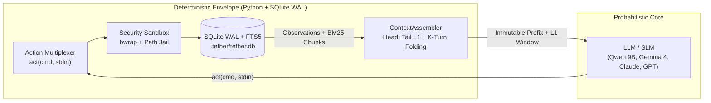

# Architecture and Literature

Most agent frameworks were designed around massive frontier models with 200k-token context windows. When you point those same frameworks at a local 8B or 9B model (`ollama/qwen3.5:9b`, `ollama/gemma4:e4b`), they immediately fail—not because the model cannot reason, but because **3,000 to 8,000 tokens of nested JSON tool schemas and raw tool outputs** flood the attention window before the agent takes its second step.

Tether's design translates four foundational works in recent AI systems research into a compact, zero-bloat Python micro-harness.



---

## 1. Theoretical Foundation

### Probabilistic Core, Deterministic Envelope — *Maia et al. (2026)*
In *"LLM-Native Applications as a Paradigm for AI-Driven Software Architecture"*, Maia et al. (2026) argue that reliable AI software must strictly separate the **probabilistic reasoning kernel** (the LLM) from a **deterministic execution envelope**.

In Tether:

- The model is responsible **only** for deciding the next command (`act(cmd, stdin)`).
- Everything else—CLI argument parsing, type coercion, KV-cache prefix preservation, observation folding, loop-stall detection, SQLite state transitions, and OS sandboxing—is enforced deterministically in Python and SQLite.

### Why a Single `act(cmd, stdin)` Multiplexer? — *Wang et al. (CodeAct, ICML 2024)*
Traditional frameworks register 15–30 separate JSON function schemas (`read_file`, `write_file`, `search_web`, `run_bash`, ...). Small models frequently hallucinate nested JSON keys or pick the wrong schema.

In *"Executable Code Actions Elicit Better LLM Agents"* (**ICML 2024**), Wang et al. demonstrated that consolidating fragmented JSON schemas into a **unified executable action space** improves agent success rates by up to **20%** while drastically shrinking prompt overhead. Tether exposes a single JSON tool—`act(cmd, stdin)`—that routes every built-in and `@tool`-decorated Python function through a familiar POSIX CLI grammar.

### Why Progressive `--help` & Bounded Views? — *Yang et al. (SWE-agent, NeurIPS 2024)*
In *"SWE-agent: Agent-Computer Interfaces Enable Automated Software Engineering"* (**NeurIPS 2024**), Yang et al. showed that raw shell interfaces and verbose outputs degrade agent performance, whereas purpose-built **Agent-Computer Interfaces (ACIs)** with compact documentation and guardrailed feedback loops significantly boost accuracy.

Tether implements this as **Progressive `--help` Disclosure**:

- The system prompt lists only a **$\le$ 12-token summary line** per enabled tool.
- Full parameter signatures (**$\le$ 60 tokens**) are revealed **Just-In-Time (JIT)** only when the model runs `<cmd> --help` or makes a syntax mistake (returning a self-healing usage hint rather than a Python traceback).

### Why Tiered L1/L2 Memory & Observation Folding? — *Packer et al. (MemGPT, 2023)*
In *"MemGPT: Towards LLMs as Operating Systems"*, Packer et al. (2023) introduced virtual context management by treating the LLM's context window as **bounded L1 working RAM** backed by **tiered L2 disk storage**.

Tether implements a deterministic three-tier memory hierarchy backed by `.tether/tether.db` (SQLite WAL + FTS5):

1. **Head + Tail L1 Active Elision**: Even within the active $K=2$ turn window, if a command emits an oversized output (`> 2,400 chars`), `ContextAssembler` keeps the first 900 chars (headers/command summary) + last 900 chars (stack trace/exit status) and elides the middle with a pointer to `mem recall <obs_id>`.
2. **Ephemeral $K$-Turn Folding**: Once an observation ages past $K=2$ steps, it is folded into a single-line tombstone:
   ```text
   [obs_1 folded: `web fetch https://...` (3,420 chars) | use `mem recall obs_1` or `mem search <query>`]
   ```
   Exception: the latest unedited read of a file is not folded (small models otherwise re-read it in a loop), and the `mem recall` hint appears only when `mem` is enabled.
3. **Sub-Millisecond SQLite FTS5 BM25 RAG**: Every raw observation and final deliverable is automatically chunked (~150 tokens per paragraph/section) and indexed into an FTS5 virtual table (`chunks_fts`) so the agent (or a parent agent) can retrieve exact passages via `mem search` or `agent query`.

---

## 2. High-Efficiency Execution Engine

### 100% KV-Cache Prefix Immutability
Local inference engines (`Ollama`, `llama.cpp`, `vLLM`) and cloud providers (`Anthropic` ephemeral prompt caching, `OpenAI` prefix caching) reuse KV-cache blocks only when the message prefix matches byte-for-byte.

- Tether **never** mutates the system prompt or `tools` array mid-session.
- Working memory pins (`[PINNED MEMORY]`) are attached to the tail message of the assembled prompt rather than injected near the top of the message list, ensuring all historical turn messages remain 100% byte-identical across steps.
- `AnthropicProvider` automatically marks the static system prompt and `act` tool schema with `cache_control: {"type": "ephemeral"}`.

### Deterministic Loop-Stall Breaker & Pre-`done` Verification Gates
Small 8B/9B models occasionally fall into a probability trap where they emit the exact same command (`web search "..."` or `bash ...`) twice in a row, or prematurely call `done` while tests or linters are failing:

- **Loop-Stall Breaker:** `Harness.execute_session` tracks the `(cmd, stdin)` signature of the previous step and intercepts consecutive duplicates before executing the tool, returning a `[LOOP DETECTED]` nudge that forces the model to advance. A companion cycle detector (`detect_cycle`) catches a 2-command cycle repeated 3 times or a 3-command cycle repeated twice (6 actions, within the last 8), skips the repeated command, nudges with `[CYCLE DETECTED]` naming the commands, and records `cycle_stall`.
- **Pre-`done` Verification Gates:** When configured via `Harness(verify=[...])`, CLI `--verify`, or Skill YAML `verify: [...]`, Tether intercepts `done` and runs each verification command inside the session's `SandboxPolicy`. It consumes **0 static prompt tokens** unless a gate exits non-zero—at which point termination is rejected and a compact `[VERIFICATION GATE FAILED]` observation is injected so the model can self-heal. A gate that errors rather than fails (sandbox violation, exit 124/126/127) ends the session `FAILED` immediately as `gate_error` instead of consuming retries.

### Connection Pooling & Thread-Local SQLite WAL Reuse
- Model providers reuse persistent `httpx.AsyncClient` connection pools across all turns in a session, eliminating repeated TCP/TLS handshakes.
- `SQLiteStore` caches thread-local SQLite connections configured with `PRAGMA journal_mode=WAL; PRAGMA synchronous=NORMAL; PRAGMA temp_store=MEMORY; PRAGMA mmap_size=134217728;`.

---

## References

1. **Maia, P. H. M., et al. (2026).** *LLM-Native Applications as a Paradigm for AI-Driven Software Architecture*.
2. **Wang, X., Chen, Y., Yuan, L., Zhang, Y., Li, Y., Peng, H., & Ji, H. (2024).** *Executable Code Actions Elicit Better LLM Agents (CodeAct)*. In **ICML 2024**. [arXiv:2402.01030](https://arxiv.org/abs/2402.01030)
3. **Yang, J., Jimenez, C. E., Wettig, A., Lieret, K., Yao, S., Narasimhan, K., & Press, O. (2024).** *SWE-agent: Agent-Computer Interfaces Enable Automated Software Engineering*. In **NeurIPS 2024**. [arXiv:2405.15793](https://arxiv.org/abs/2405.15793)
4. **Packer, C., Wooders, S., Lin, K., Fang, V., Patil, S. G., Stoica, I., & Gonzalez, J. E. (2023).** *MemGPT: Towards LLMs as Operating Systems*. [arXiv:2310.08560](https://arxiv.org/abs/2310.08560)
