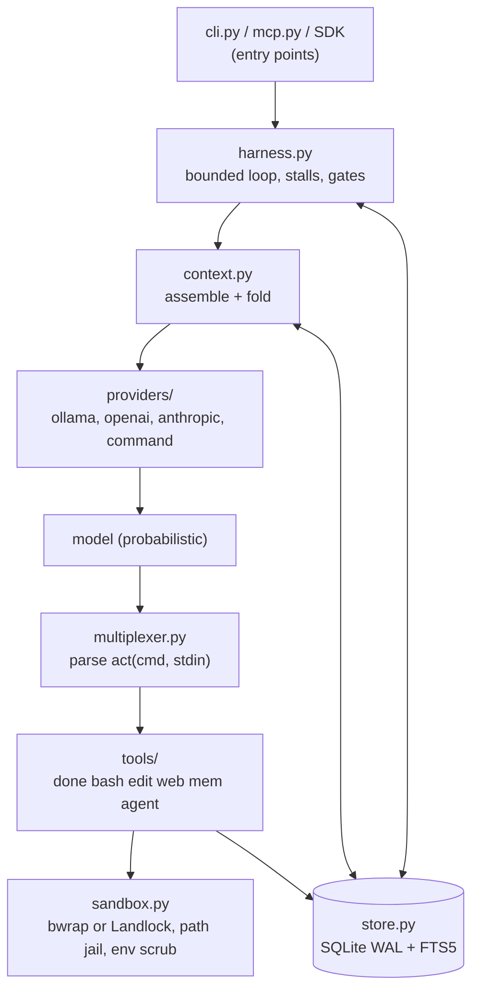

# Architecture overview

*For: contributors and agents who need the map before they change anything. After this page you can follow one step of a session through the code, name each module's job and know where a change belongs.*

Tether is one Python package (`tether/`), one SQLite file per project and no server. A session is a loop: assemble what the model sees, ask the model for one command, run it inside the jail, record everything, repeat until a gate says the work is finished.

Everything left of "model" and right of "parse" is deterministic. The model is called once per step and only ever returns one command.

## One step, end to end

1. **Assemble.** `context.py` builds the prompt: the fixed system prompt and `act` schema, the history as structured tool calls and results, your pinned notes on the last message. Old outputs are folded to tombstones and long ones elided to head and tail ([context and folding](../concepts/context-and-folding.md)).
2. **Ask.** A provider (`providers/`) sends it. Three thin `httpx` adapters (Ollama, OpenAI-compatible, Anthropic) plus a declarative layer that can wrap any command. It retries what is safe to retry and turns failures into messages that say what to do.
3. **Parse.** `multiplexer.py` takes `act(cmd, stdin)`, repairs trivial quirks (a leading `$`, a heredoc in `cmd`, a tool name instead of `act`) and finds the command. Unknown or malformed commands become a usage hint, never an exception.
4. **Run.** The tool executes. `bash` and `edit` go through `sandbox.py`: paths confined to the workspace, secrets masked, a scrubbed environment, `bwrap` or Landlock on Linux. Tools that need the network go through the same policy.
5. **Record.** `store.py` writes the turn, the full output and its searchable chunks to SQLite, and the workspace tracker snapshots the first version of each file that changed.
6. **Notes.** The harness may append a short note to the observation: an auto-test result, a regression line, a nudge, a loop warning. Each is bounded, deterministic and costs no model call ([the repair loop](../concepts/repair-loop.md)).
7. **Decide.** `harness.py` checks the stop conditions: `done` (and your `verify` gates), steps, tokens, stall counters. Otherwise back to step 1.

## The modules

| Module | Job | Read next |
|---|---|---|
| `cli.py`, `api.py`, `mcp.py` | Commands, JSON output and exit codes, the optional MCP server | [CLI](../reference/cli.md), [agent interface](../reference/agent-interface.md) |
| `harness.py` | The loop, stall guard, gates, workers, `send`, sub-agent spawn | [Harness](../reference/harness.md) |
| `pipeline.py` | Declarative multi-stage workflows | [Pipelines](../guides/advanced/pipelines.md) |
| `context.py` | Prompt assembly, folding, restart summaries, token estimate | [Context and store](../reference/context-and-store.md) |
| `store.py` | SQLite tables, FTS5 chunks, pins, inbox, snapshots | same |
| `multiplexer.py`, `decorator.py` | `act` parsing, quirk repair, `@tool` | [Multiplexer](../reference/multiplexer-and-decorator.md) |
| `sandbox.py`, `gates.py` | The jail, limits, approvals; pre-check of verify gates | [Sandbox](../reference/sandbox-and-skills.md) |
| `workspace.py`, `diff.py`, `unchanged.py`, `trace.py` | Change tracking, `tether diff`, no-op and breakage detection, runtime traces | [Repair loop](../concepts/repair-loop.md) |
| `providers/` | Model transports and `providers.yaml` | [Providers](../reference/providers.md) |
| `tools/` | `done`, `bash`, `edit`, `web`, `mem`, `agent` | [Tools](../reference/tools.md) |
| `skills.py` | Skills: instructions + defaults + tools | [Skills](../guides/basic/skills.md) |
| `worktree.py` | Git worktrees for `--worktree` | [Own branch](../guides/advanced/own-branch.md) |
| `doctor.py`, `export.py`, `retro.py`, `progress.py` | Setup check, transcripts, post-mortem, live feedback | [Review and debug](../guides/basic/review-and-debug.md) |

## The planes

It helps to think in four layers, because each has different rules about change:

- **Control plane** (`harness.py`, `pipeline.py`): when a session starts, continues, pauses and ends. Deterministic, tested by golden traces.
- **State plane** (`context.py`, `store.py`): what is remembered and what the model sees. The cache rules apply: the start of the prompt never changes.
- **Action plane** (`multiplexer.py`, `tools/`): what the model can do. Zero optional tools by default.
- **Security plane** (`sandbox.py`): what it may touch. Enforced by the kernel and by code, never by the prompt.

## Where does my change go?

| You want to... | Put it in |
|---|---|
| Support a new model server | a provider entry in `providers.yaml`, or a new adapter in `providers/` |
| Give the model a new ability | a `@tool` function, or a skill, not the harness |
| Help the model recover from a mistake | a note in the observation, or a multiplexer normaliser; not the system prompt |
| Change what the model sees | `context.py`, with a golden trace and a token-budget test |
| Restrict or allow something | `sandbox.py`; never by instructing the model |

Before any of these, read the relevant entries in the [decisions register](decisions.md); a change that contradicts one is a decision change and needs the product owner.
