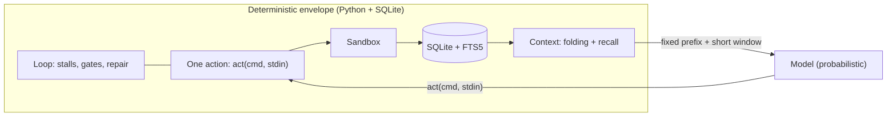

# Concepts

*For: people who want to understand why tether is built the way it is. Each page takes one problem tether had to solve, shows how the research on it led to the solution, and reports what we measured. After this section you can judge whether a design choice fits your own use.*

Tether is not a collection of features. Each piece exists because a small model failed in a specific way, and the fix is either backed by a published result or by our own measurement. These pages follow the same shape: **the problem, what the research says, what tether does, and what we got from it.** Not every feature has a paper behind it, so only the ones with an interesting story are here. For every decision, including those without a story, see the [decisions register](../architecture/decisions.md).

## The idea underneath everything

Reliable AI software separates a *probabilistic* core (the model, which decides what to try) from a *deterministic* envelope (ordinary code, which decides what is allowed, what is remembered and when the work is finished) (Maia et al., 2026). In tether the model only ever chooses the next command. Everything else is Python and SQLite. The pages below are the envelope, one problem at a time.

## The problems and their pages

| Problem | Concept | The short answer |
|---|---|---|
| Tool descriptions eat a small model's memory and it picks the wrong one | [One action for everything](one-action-primitive.md) | A single `act(cmd, stdin)` and plain command-line grammar |
| Even one tool description per tool is too many | [Help only when asked](progressive-help.md) | One short line per tool, full usage on demand |
| Long outputs fill the window and the model forgets the task | [Context and folding](context-and-folding.md) | Fold old output to one line, keep it searchable in SQLite |
| Changing the prompt each step throws away the model's cache | [A prefix that never changes](kv-cache-and-static-prefix.md) | Never edit the start of the conversation |
| The model says "done" when it is not | [The deterministic envelope](deterministic-envelope.md) | Only a command you choose can end the task |
| The model repeats itself or keeps patching a wrong idea | [Loops, stalls and fresh starts](stalls-and-restarts.md) | Detect it, warn, restart from a clean description, hand back |
| A repair makes things worse and the model does not notice | [The repair loop around tests](repair-loop.md) | Run the tests after every edit and show what changed |
| The model thinks until the window is full and answers nothing | [Thinking and sampling](thinking-and-sampling.md) | Bound the thinking, leave sampling to the model |

## How we evaluate a concept

A concept stays only if it moves the one number tether is judged by (how many real coding exercises a small local model finishes), or if it keeps that number from falling while something else improves. When we tried an idea and it did not move it, it is on the [Not adopted](../architecture/decisions.md#not-adopted-and-why) list with its evidence. The method and the results per release are in [Benchmarks](../benchmarks/index.md).

## References

The full reference list is at the bottom of each page that uses it. The foundations: Maia et al. (2026), Wang et al. (CodeAct, ICML 2024), Yang et al. (SWE-agent, NeurIPS 2024), Packer et al. (MemGPT, 2023), Olausson et al. (ICLR 2024), Zhong et al. (LDB, ACL 2024), Huang et al. (ASE 2026) and Wang-Lin et al. (2026).
