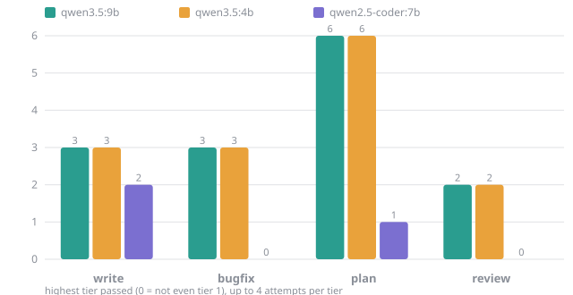
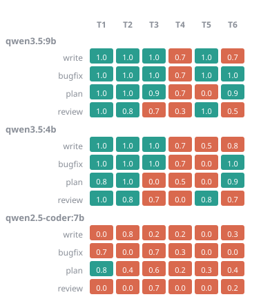
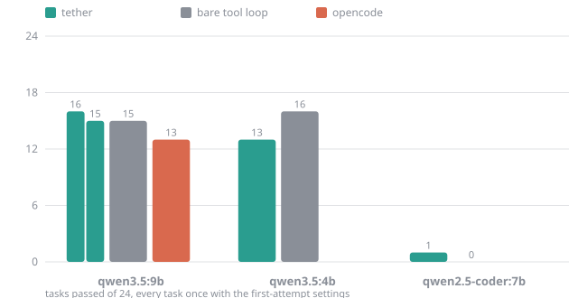
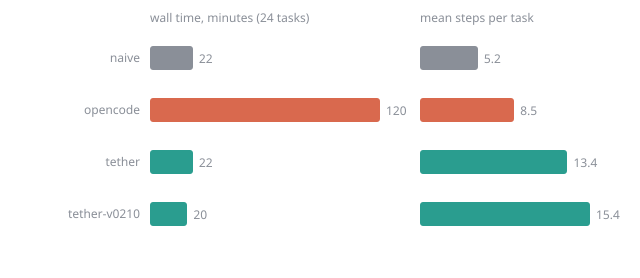

# Coding Ladder results: local models

*For: people deciding which small local model to run with tether and what to expect from it. It shows where three local models stop on the [Coding Ladder](index.md), whether tether holds them back, and what limits them. Every number comes from the committed baseline in `bench/ladder/baseline/`; the charts are redrawn from it with `python3 bench/ladder/charts.py`.*

## What was run

| Model | Size | Context used | How it is served |
|---|---|---|---|
| `qwen3.5:9b` | 9B, thinking mode | 40,960 | Ollama, one 8 GB GPU |
| `qwen3.5:4b` | 4B, thinking mode | 81,920 | Ollama, one 8 GB GPU |
| `qwen2.5-coder:7b` | 7B, no thinking mode | 131,072 | Ollama, one 8 GB GPU |

The context is the largest window that stays fully in GPU memory for that model. Two experiments, both on the 24 tasks of the [ladder](index.md):

1. **The climb.** Each model goes up each kind's tiers, up to four attempts per tier, until a tier beats it.
2. **The harness comparison.** Every task once, with the first-attempt settings, through tether and through a **bare tool loop**: a few lines of code that give the same model a shell and a file tool and nothing else. The bare loop is what the model does with no harness.

One run per cell. A task is a pass when every hidden test passes (plans and reviews at 0.7).

## How far each model climbs

| Model | write | bugfix | plan | review |
|---|---|---|---|---|
| `qwen3.5:9b` | 3 | 3 | 6 | 2 |
| `qwen3.5:4b` | 3 | 3 | 6 | 2 |
| `qwen2.5-coder:7b` | 2 | 0 | 1 | 0 |

The grid shows the first-attempt score of every task. Green passed, red did not:

**What the climb shows**

- **The two qwen3.5 models reach the same tiers.** The 4B model is not a step down from the 9B on this ladder. Size is not what decides tier 4.
- **Tier 4 is a wall.** Both models stop on the same two code tasks: pagination, where the cases (page 0, page size 0) are not stated, and the two-bug repair, where one bug is reported and the other is not. Thinking on, more steps and temperature 0 left the score unchanged on every attempt (best 4 of 6 and 2 of 3 hidden tests). The model does the stated part and does not check what was left unsaid. See issue [#200](https://github.com/igormcsouza/tether/issues/200).
- **Plans are easy for them, reviews are not.** Both reach plan tier 6. A review stops at tier 3, where three bugs are planted: they find the SQL injection and the mutable default argument and miss the file that is never closed.
- **Thinking helps in the middle tiers.** One attempt with thinking on turned bugfix-3 from 0.67 to 1.00 and plan-4 from 0.62 to 0.78 for the 9B. It does not move tier 4.
- **`qwen2.5-coder:7b` works, with a low ceiling.** It has no thinking mode and often writes whole files without reading them first. It passes the simplest write and plan tasks and little else. Tether translates the tool-call forms it writes (a function-style `edit(file=…, content=…)`, plain-text JSON, `done --stdin`) into real commands; without that it scores zero.

## Does tether hold the model back?

| Model | tether (current) | bare tool loop | opencode |
|---|---|---|---|
| `qwen3.5:9b` | 16 / 24, mean 0.82 | 15 / 24, mean 0.80 | 13 / 24, mean 0.62 |
| `qwen3.5:4b` | 13 / 24, mean 0.70 | 16 / 24, mean 0.78 | not run |
| `qwen2.5-coder:7b` | 1 / 24, mean 0.28 | 0 / 24, mean 0.10 | not run |

On the 9B an earlier build of tether passed 15 of 24 (mean 0.81), shown as the second tether bar. Two runs of the same model differ by one task, which is the run-to-run spread to keep in mind: **a difference of one or two tasks is noise.**

- **tether does not hold the 9B back.** It matches the bare loop, and the sandbox, the `--verify` gates and the session store come on top at no score cost. opencode, a full-featured agent, scored lower and took about six times as long on the same model.
- **On the 4B the bare loop is ahead by three tasks.** That is at the edge of the noise and it is the one cell where tether looks worse. Treat it as an open question, not a verdict.
- **On the 7B tether is what makes the model usable.** The bare loop cannot use its tool calls at all (0 of 24); tether turns them into work.

### What tether costs in steps and time

On the 9B tether takes about 13 steps per task against about 5 for the bare loop, at a similar total time. Most of the extra steps are reads: 63% of tether's steps were file reads and a quarter of those repeated an earlier read ([#199](https://github.com/igormcsouza/tether/issues/199)).

## What to expect

| If your model is like… | Expect |
|---|---|
| `qwen3.5:9b` or `4b` | Tiers 1 to 3 of write and bugfix, plans through tier 6, reviews of two planted bugs. Anything that relies on cases you did not state is where it fails; say them in the goal. |
| `qwen2.5-coder:7b` or another model without a thinking mode | Short single-file changes. Give it the file and the place. Use `--verify` so a wrong answer is caught. |

Practical settings that came out of the ladder:

- **Say the edge cases.** Tier 4 fails because they are unsaid, and neither a bigger window nor more attempts changes that.
- **Use `--verify` with your own tests.** The model's `done` is not proof; your gate is.
- **Leave thinking on for plans and multi-step fixes, off for one-file edits.** It costs time and rarely changes a tier-1 result.
- **Keep the context at the largest window that stays in GPU memory.** A window that spills to system memory slows every step.

## How reliable are these numbers

One run per cell at temperature 0.2. Two runs of the same build differ by about one task in 24, and the 9B tether runs show it (15 and 16). The ladder tells you where a model stops, a rough size of the gap between harnesses, and which tasks are out of reach. It cannot rank two harnesses that are one or two tasks apart. To judge a change to tether, use the paired comparison in the [benchmark guide](../benchmarks.md) instead of a single run.

Known limits are tracked as issues: [#200](https://github.com/igormcsouza/tether/issues/200) (unsaid cases), [#199](https://github.com/igormcsouza/tether/issues/199) (repeated reads) and [#183](https://github.com/igormcsouza/tether/issues/183) (long empty thinking turns on `qwen3.5`).
