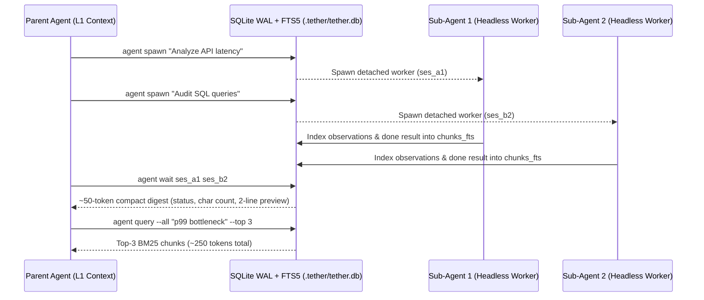

# Async Multi-Agent Orchestration

In multi-agent workflows, returning a sub-agent's full 10,000-token research output directly into a parent 9B model's prompt immediately overflows its context window.

Tether solves this by making sub-agents **always asynchronous** and storing all child observations and deliverables in the shared `.tether/tether.db` **SQLite FTS5 BM25 index**.



## Subcommands of `agent`

Enable the `agent` tool (`--tools agent` or `Harness(tools=["agent"])`) to give a parent session full orchestration capabilities:

### 1. Spawn Detached Child Sessions (`agent spawn`)

```text
act(cmd='agent spawn --skill researcher --tools web,mem "Investigate Redis 8 vector benchmarks"')
# Returns immediately: ses_8f3a91c02b1e
```

!!! note "Strict Sandbox Inheritance"
    A child session spawned via `agent spawn` inherits (or narrows) its parent session's `SandboxPolicy`. A `read-only` parent can never escalate a child to `workspace-write`.

### 2. Wait for Compact Digests (`agent wait`)

Polls SQLite asynchronously until all specified child sessions finish, returning a **~50-token digest** per child so the parent's L1 context stays lean:

```text
act(cmd="agent wait ses_8f3a91c02b1e ses_4d2e19a87c01")
```

Example output:

```text
ses_8f3a91c02b1e [COMPLETED] steps=4 chars=6,840 chunks=14
Preview: # Redis 8 Vector Benchmarks — HNSW indexing achieves 42k QPS at 0.95 recall...
(Use `agent query ses_8f3a91c02b1e <query>` for BM25 RAG or `agent read ses_8f3a91c02b1e --full`)
```

### 3. Targeted BM25 RAG Retrieval (`agent query`)

Instead of reading 6,840 characters into active memory, the parent queries the SQLite FTS5 `chunks_fts` table across a specific child session or `--all` child sessions:

```text
act(cmd='agent query --all "HNSW recall latency" --top 3')
```

### 4. Status, Full Read, and Live Messaging (`status`, `read`, `send`)

```text
act(cmd="agent status ses_8f3a91c02b1e")
act(cmd="agent read ses_8f3a91c02b1e --full")
act(cmd='agent send ses_8f3a91c02b1e "Now check memory overhead at 10M vectors"')
```
